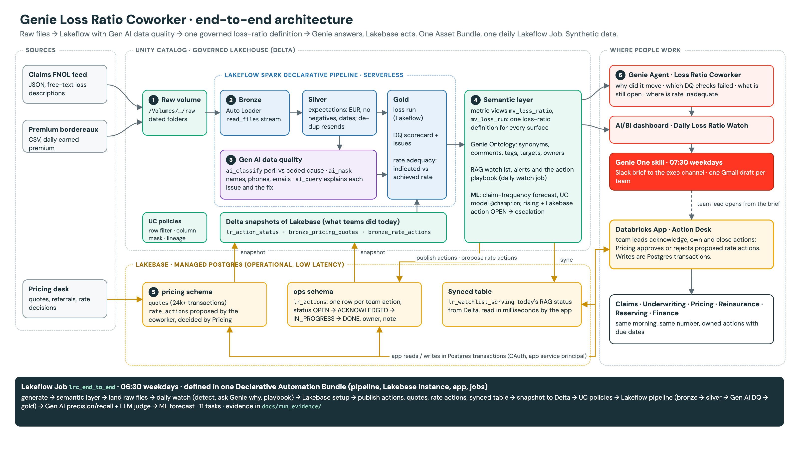
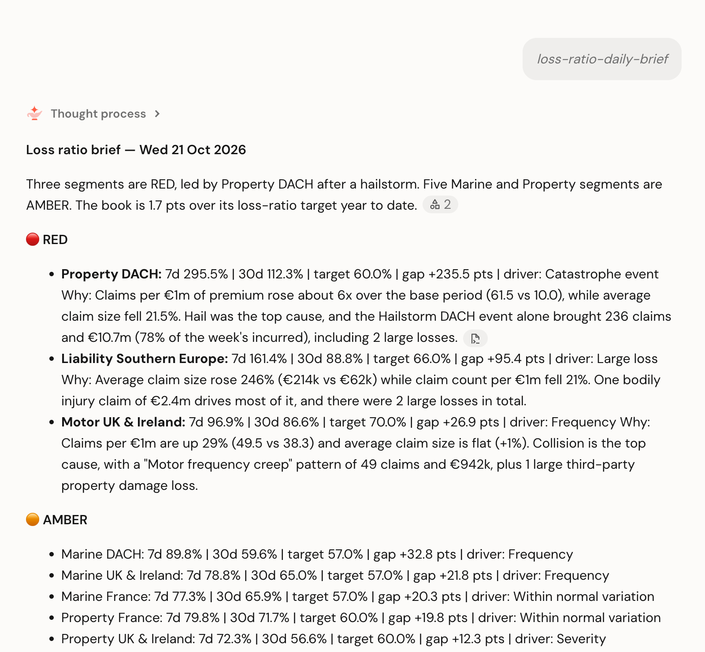
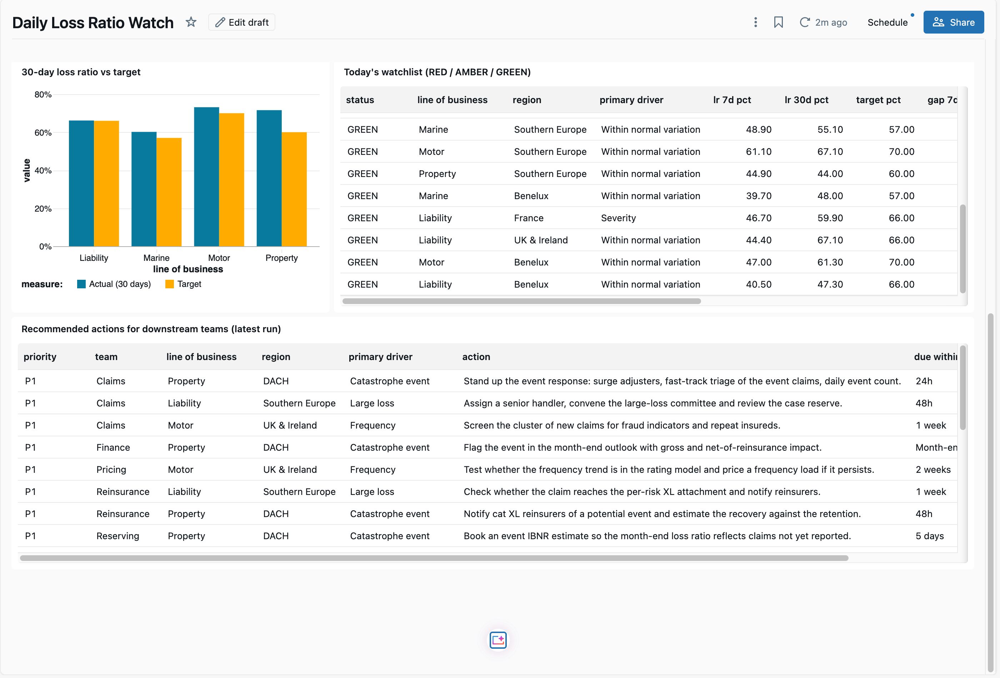
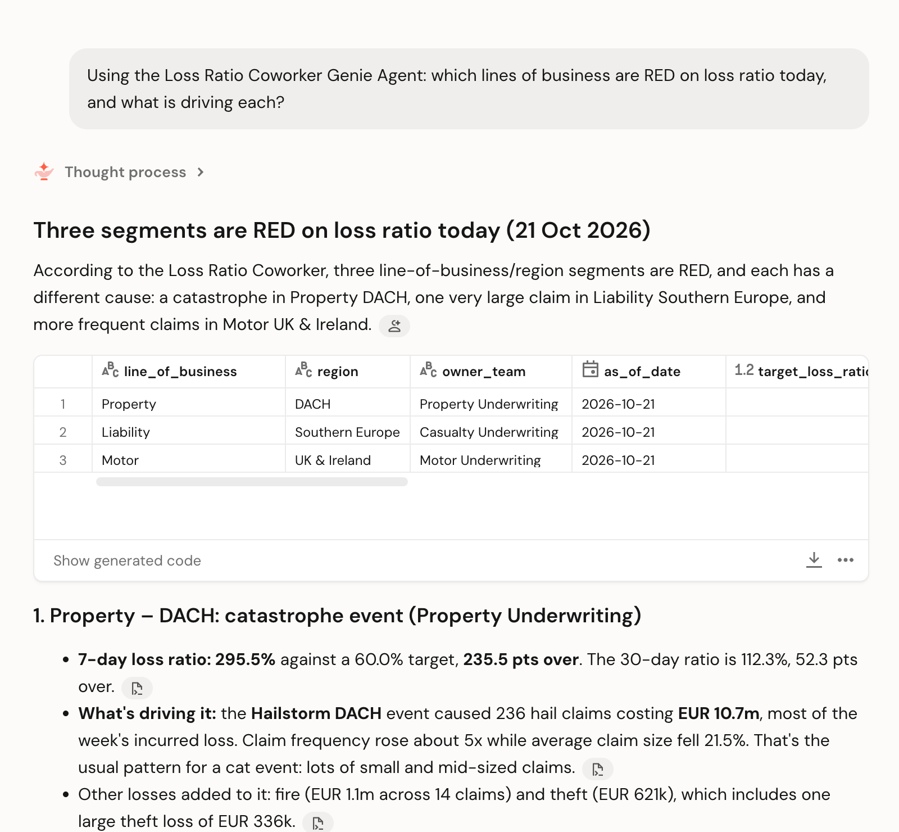

# Genie Loss Ratio Coworker

**Manage the insurance loss ratio daily, not monthly: raw claim files land in a Unity Catalog volume, a Lakeflow
pipeline cleans them with Gen AI data-quality checks, one governed loss-ratio definition feeds Genie, and the actions
it assigns live in Lakebase where teams update them through a Databricks App.**

Every weekday morning the coworker finds the segments whose loss ratio moved, explains *why* (frequency, severity,
catastrophe, large loss), recommends owned actions for Claims, Underwriting, Pricing, Reinsurance, Reserving and Finance,
posts the brief to **Slack**, and leaves each team's actions as a **Gmail draft** ready for the executive to send.
Team leads acknowledge and close their actions in the **Action Desk** app on **Lakebase**, and Pricing approves the rate
changes the coworker proposes. All data is synthetic.



**Read next:** [Solution summary: story, components and the script for every step](docs/SOLUTION.md) ·
[Run evidence from a real run](docs/run_evidence/README.md)

## Solution summary

| Capability | What it does | Script |
|---|---|---|
| Raw landing | Claim FNOL (JSON) and premium bordereaux (CSV) land in a UC volume, with seeded defects | [`src/raw/03_land_raw_files.py`](src/raw/03_land_raw_files.py) |
| **Lakeflow ETL** | Auto Loader bronze → silver with expectations and de-dup → gold loss run and rate adequacy (serverless SDP) | [`src/pipeline/lrc_ingest_pipeline.sql`](src/pipeline/lrc_ingest_pipeline.sql), [`resources/lrc_pipeline.yml`](resources/lrc_pipeline.yml) |
| **Gen AI data quality** | `ai_classify` peril vs coded cause, `ai_mask` personal data, `ai_query` explanation and fix, inside the pipeline | [`src/pipeline/lrc_ingest_pipeline.sql`](src/pipeline/lrc_ingest_pipeline.sql) (`silver_claims_ai_checked`, `dq_claims_issues`, `dq_daily_scorecard`) |
| Gen AI evaluation | Precision and recall of the AI checks against the seeded defects, every run | [`src/genai/04_evaluate_genai_dq.py`](src/genai/04_evaluate_genai_dq.py) |
| Semantic layer | Metric views, Genie Ontology, targets, watchlist | [`src/setup/02_semantic_layer.py`](src/setup/02_semantic_layer.py) |
| Detect and explain | RED/AMBER detection, Genie Agent *why*, action playbook | [`src/jobs/daily_loss_ratio_watch.py`](src/jobs/daily_loss_ratio_watch.py) |
| **Lakebase** setup | Instance, database, `ops` and `pricing` schemas, seeded quotes | [`src/lakebase/01_setup_lakebase.py`](src/lakebase/01_setup_lakebase.py), [`_lakebase_conn.py`](src/lakebase/_lakebase_conn.py), [`resources/lrc_lakebase.yml`](resources/lrc_lakebase.yml) |
| **Lakebase** transactions | Publish actions, record quotes and referrals, propose rate actions, synced watchlist table | [`src/lakebase/02_publish_and_transact.py`](src/lakebase/02_publish_and_transact.py) |
| **Lakebase** → Delta | Team status and pricing snapshotted back for Genie and Lakeflow | [`src/lakebase/03_snapshot_to_delta.py`](src/lakebase/03_snapshot_to_delta.py) |
| Action Desk app | Teams update status, owner, note; Pricing approves rate actions (Postgres transactions) | [`app/action_desk/app.py`](app/action_desk/app.py), [`resources/lrc_app.yml`](resources/lrc_app.yml) |
| Orchestration | One Lakeflow Job runs every step; one bundle deploys everything | [`resources/lrc_jobs.yml`](resources/lrc_jobs.yml) (`lrc_end_to_end`), [`databricks.yml`](databricks.yml) |
| Genie Agent, dashboard, Genie One | Explain, answer, brief, Slack post, Gmail drafts | [`deploy/genie_agent.py`](deploy/genie_agent.py), [`deploy/dashboard.py`](deploy/dashboard.py), [`skills/loss-ratio-daily-brief.md`](skills/loss-ratio-daily-brief.md) |
| Genie Agent benchmark | Asks the deployed agent CUO questions, scores against ground-truth SQL (10/10) | [`deploy/genie_benchmark.py`](deploy/genie_benchmark.py) → [`docs/run_evidence/06_genie_agent.md`](docs/run_evidence/06_genie_agent.md) |
| Run evidence | Job run, notebook outputs, pipeline expectations, query results, Lakebase state, committed as Markdown + CSV | [`deploy/collect_run_evidence.py`](deploy/collect_run_evidence.py) → [`docs/run_evidence/`](docs/run_evidence/) |

The original Genie One flow is still in [`docs/diagrams/flow.png`](docs/diagrams/flow.png).

---

## For executives: what changes

| Moment | Today | With the coworker |
|---|---|---|
| 07:30 | Nothing on loss ratio until the month-end pack | Genie One posts the brief in Slack: what's RED, why, who's acting |
| Exec meeting | "Why is Property up?" becomes an analyst ticket | `@Genie why did DACH Property jump?` is answered in the meeting, with the SQL |
| Reinsurance | Hears about the event at month-end | Has a P1 action with a 48-hour due date the same morning |
| Follow-up | Writes six emails to team leads | Opens Gmail: six drafts, one per team, with actions, due dates and the why. Review, send |
| Board pack | Debates whose loss ratio is right | One governed number, next to the AM Best and Global Insurance Customer benchmarks |

Context: the US P&C industry combined ratio was **92.9% in FY2025** (AM Best, 96.6% in FY2024); a Global Insurance Customer reported a
**90.6%** P&C combined ratio for FY2025 (94.1% undiscounted). In a market this tight, a few points of loss ratio decide
the year, and they move between month-ends.

| Morning brief (Genie One skill) | Recommended actions (dashboard) |
|---|---|
|  |  |

| Genie One writes the Slack post + Gmail drafts | Genie One explains the RED segments |
|---|---|
|  |  |

More: [dashboard](docs/screenshots/01_dashboard.png) · [skill in Genie One](docs/screenshots/05_skill_invoke.png) ·
[actions by team](docs/screenshots/07_brief_actions_by_team.png) · [scheduled task](docs/screenshots/08_scheduled_task.png) ·
[Gmail drafts](docs/screenshots/11_genie_one_gmail_drafts.png)

---

## For builders: what's in the repo

| Path | What it is |
|---|---|
| `src/setup/01_generate_loss_run.py` | Synthetic European commercial P&C book (150k policies, ~77k claims, daily earned premium) with three seeded events: a DACH hailstorm, a UK motor frequency creep and a EUR 2.4m bodily-injury loss |
| `src/setup/02_semantic_layer.py` | Gold daily loss run, targets/thresholds/owners, public benchmarks, **metric views** `mv_loss_ratio` and `mv_loss_run` (YAML 1.1 with display names, synonyms and formats), the RAG watchlist, alert tables, comments and tags for **Genie Ontology** |
| `src/jobs/daily_loss_ratio_watch.py` | Daily job: detect RED/AMBER → ask the Genie Agent *why* → action playbook per team → Delta audit trail → Slack Block Kit and Teams Adaptive Card |
| `deploy/genie_agent.py` | Creates the **Loss Ratio Coworker** Genie Agent (tables, instructions, example SQL, sample questions) |
| `deploy/dashboard.py` | Creates and publishes the **Daily Loss Ratio Watch** AI/BI dashboard |
| `skills/loss-ratio-daily-brief.md` | The **Genie One skill**: brief → Slack post → one Gmail draft per team, and how to schedule it |
| `src/raw/03_land_raw_files.py` | Lands synthetic claim FNOL files (JSON) and premium bordereaux (CSV) in the `raw` volume, with seeded data-quality defects |
| `src/pipeline/lrc_ingest_pipeline.sql` | **Lakeflow Spark Declarative Pipeline**: Auto Loader bronze, silver with expectations, **Gen AI data quality** (`ai_classify`, `ai_mask`, `ai_query`), gold loss run, DQ scorecard, rate adequacy |
| `src/genai/04_evaluate_genai_dq.py` | Scores the Gen AI checks against the seeded defects (precision, recall, F1) |
| `src/lakebase/01–03_*.py` | **Lakebase**: setup (`ops`, `pricing`), publish actions + pricing transactions + synced table, snapshot back to Delta |
| `app/action_desk/` | **Databricks App** on Lakebase: team status updates and rate-action approvals |
| `resources/*.yml` | Bundle resources: Lakebase instance, pipeline, app, jobs (`lrc_end_to_end` runs everything) |
| `deploy/collect_run_evidence.py` | Writes readable run evidence to `docs/run_evidence/` |
| `docs/SOLUTION.md` | Solution summary: story, why each component, every step and its script |
| `docs/run_evidence/` | Committed output of a real end-to-end run |
| `docs/APPROACH.md` | Detailed design: problem, principles, detection logic, playbook, governance, 6-week rollout, risks |
| `docs/CONNECT_SLACK_TEAMS_GMAIL_OUTLOOK.md` | Step-by-step setup for Slack, Microsoft Teams, Gmail and Outlook: Genie One connectors, the Genie apps, the webhook job, a checklist and troubleshooting |
| `docs/article/linkedin_article.md` | The accompanying article |

### Quick start

Prerequisites: a Unity Catalog workspace with serverless compute and a serverless SQL warehouse, Genie One enabled,
the Databricks CLI.

```bash
export DATABRICKS_CONFIG_PROFILE=<profile>
export LRC_CATALOG=<catalog> LRC_WAREHOUSE_ID=<warehouse-id>

# 1. Deploy the jobs, then build the data and semantic layer
databricks bundle deploy --var catalog=$LRC_CATALOG --var warehouse_id=$LRC_WAREHOUSE_ID
databricks bundle run lrc_setup --var catalog=$LRC_CATALOG --var warehouse_id=$LRC_WAREHOUSE_ID

# 2. Genie Agent and dashboard
python deploy/genie_agent.py        # prints GENIE_SPACE_ID=...
python deploy/dashboard.py

# 3. Redeploy with the agent id and run the daily watch (dry run)
databricks bundle deploy --var catalog=$LRC_CATALOG --var warehouse_id=$LRC_WAREHOUSE_ID --var genie_space_id=<id>
databricks bundle run lrc_daily_watch --var catalog=$LRC_CATALOG --var warehouse_id=$LRC_WAREHOUSE_ID --var genie_space_id=<id>
```

End-to-end scenario (Lakeflow, Gen AI data quality, Lakebase, Action Desk app):

```bash
# 4. One job runs every step: generate → land raw files → watch → Lakebase → snapshot → Lakeflow pipeline → Gen AI eval
databricks bundle run lrc_end_to_end --var catalog=$LRC_CATALOG --var warehouse_id=$LRC_WAREHOUSE_ID --var genie_space_id=<id>

# 5. The app needs the Lakebase database from step 4: redeploy, then start it
databricks bundle deploy --var catalog=$LRC_CATALOG --var warehouse_id=$LRC_WAREHOUSE_ID --var genie_space_id=<id>
databricks bundle run lrc_action_desk --var catalog=$LRC_CATALOG --var warehouse_id=$LRC_WAREHOUSE_ID --var genie_space_id=<id>

# 6. Refresh the Genie Agent with the new tables and commit the run evidence
python deploy/genie_agent.py
python deploy/collect_run_evidence.py
```

Then in Genie One: connect **Slack** and **Gmail** or **Microsoft 365** (for Outlook), create the skill from
`skills/loss-ratio-daily-brief.md`, run `/loss-ratio-daily-brief`, and ask *"Schedule this every weekday at 07:30"*.
For Slack, Microsoft Teams, Gmail and Outlook setup (connectors, the Genie apps, webhooks, write-tool enablement and
troubleshooting) follow [`docs/CONNECT_SLACK_TEAMS_GMAIL_OUTLOOK.md`](docs/CONNECT_SLACK_TEAMS_GMAIL_OUTLOOK.md).

### Design notes

- **One definition.** Loss ratio = incurred ÷ earned, defined once in a metric view; every surface reads it.
- **Deterministic detection.** Thresholds (per line, in `lr_targets`) and the playbook are rules; Genie explains, it doesn't decide.
- **Context matters.** Genie One searches every Genie asset you can see. Name the agent in the skill, or pin it to a
  Slack/Teams channel, so loss-ratio questions stay on the governed agent.
- **Human on the send button.** The Gmail connector drafts but cannot send; the executive reviews every instruction.
- **Governance.** Genie One, its connectors and Genie Agents run with the user's Unity Catalog permissions through Unity
  Gateway. Connector write tools start read-only and are enabled per workspace by an admin.
- **Status.** The Genie apps for Slack and Teams are Public Preview and skill sharing is Beta at the time of writing.

### Sources

- AM Best, *US Property/Casualty 2025 Financial Results*: <https://www.ambest.com/bestlink/IndustryReports/pcssaft1new.pdf>
- Databricks docs: [Genie One in Slack](https://docs.databricks.com/aws/en/genie-one/genie-slack) ·
  [Genie in Microsoft Teams](https://docs.databricks.com/aws/en/integrations/msft-teams) ·
  [Genie One connectors](https://docs.databricks.com/aws/en/genie-one/external-sources) ·
  [Genie Ontology](https://docs.databricks.com/aws/en/genie/genie-ontology) ·
  [Metric views](https://docs.databricks.com/aws/en/uc-semantics/metric-views/)

*Synthetic data only. Global Insurance Customer and AM Best figures are public and used as market context, not as targets. Not an official
Databricks product.*
