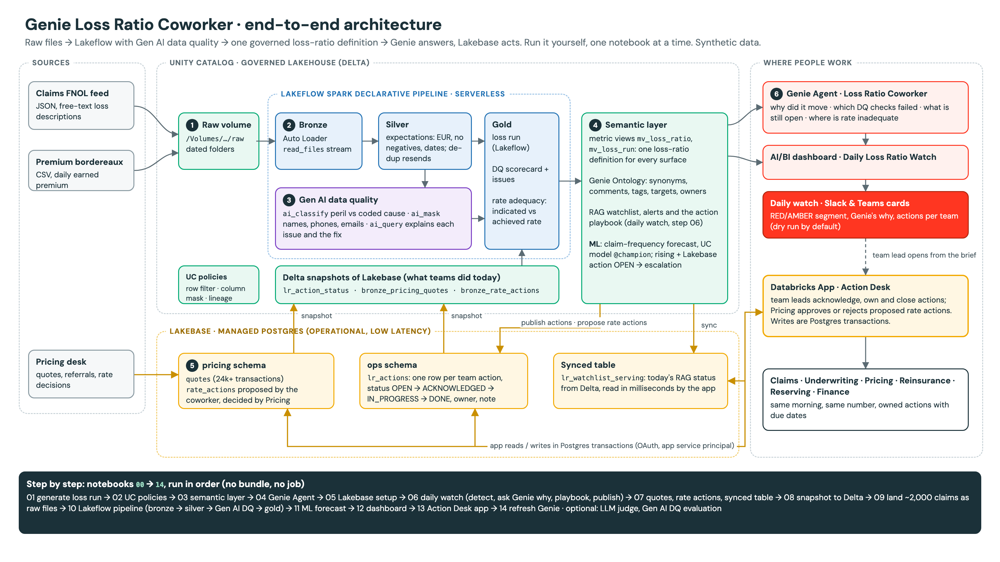

# Genie Loss Ratio Coworker

Manage an insurance loss ratio **daily, not monthly**, and learn how it is built on Databricks by running one notebook
at a time: synthetic claims → Unity Catalog governance → one governed loss-ratio definition → Genie explains why it
moved → actions in Lakebase → a Lakeflow pipeline with Gen AI data-quality checks → an ML forecast → a dashboard and an
app. All data is synthetic.

## Use case

The Chief Underwriting Officer of a European commercial P&C insurer (property, motor fleets, liability, marine across
five regions) is measured on the combined ratio against plan. Today, a deteriorating segment shows up in the month-end
pack three to six weeks after the claims arrived.

The coworker checks the book every morning instead:

1. **Detect.** It finds the segments (line of business × region) whose 7-day or 30-day loss ratio has moved above
   target, and marks them RED, AMBER or GREEN.
2. **Explain.** It asks a Genie Agent *why*: claim frequency or severity, a catastrophe or a single large loss.
3. **Act.** It assigns owned actions, with due dates, to Claims, Underwriting, Pricing, Reinsurance, Reserving and
   Finance. Teams update them in an app on Lakebase, and Pricing approves or rejects the rate changes it proposes.
4. **Trust the data.** On arrival, Gen AI checks flag claims whose cause-of-loss code contradicts the description,
   and personal data typed into free text. Unity Catalog masks it and limits each claims team to its own region.
5. **Look ahead.** A model forecasts next week's claim count and escalates segments where claims are rising and the
   team's action is still open.

The synthetic book has three planted events for the coworker to find:

| Event | Segment | What the coworker should say |
|---|---|---|
| Hailstorm (last 6 days) | Property · DACH | RED, catastrophe: surge claims handling, notify cat reinsurers, book event IBNR |
| Frequency creep (last 3 weeks) | Motor · UK & Ireland | RED, frequency: review renewals and pricing, screen the claim cluster for fraud |
| One EUR 2.4m bodily-injury claim | Liability · Southern Europe | RED, large loss: senior handler, check the per-risk reinsurance attachment |

## Architecture

| Layer | Databricks feature | Notebooks |
|---|---|---|
| Synthetic source systems | Delta tables, a Unity Catalog volume for raw files | 01, 09 |
| Governance | Unity Catalog row filter and column mask, comments and tags | 02, 03 |
| One loss-ratio definition | Metric views (`mv_loss_ratio`, `mv_loss_run`) and the daily watchlist view | 03 |
| Explain | Genie Agent on the metric views, called by the daily watch through the Conversation API | 04, 06, 14 |
| Operational store | Lakebase Postgres: actions, quotes, rate actions, a synced table, snapshots back to Delta | 05, 07, 08 |
| Ingestion and data quality | Lakeflow Spark Declarative Pipeline: Auto Loader, expectations, `ai_classify`, `ai_mask`, `ai_query` | 10 |
| Forecast | scikit-learn model tracked with MLflow and registered in Unity Catalog | 11 |
| Where people work | AI/BI dashboard, Genie, Databricks App (Action Desk), Slack and Teams cards | 06, 12, 13 |

## Step-by-step guide

### Before you start

- A Unity Catalog workspace with **serverless** notebooks, SQL warehouses and Lakeflow pipelines, plus **Genie**,
  **Lakebase**, **Databricks Apps** and **Foundation Model APIs** (for `ai_classify`, `ai_mask` and `ai_query`).
- A catalog where you can create a schema.
- Lakebase (one CU_1 instance) and the app keep running until you delete them: see *Clean up*.

### Set up

1. In the workspace, go to **Workspace → Create → Git folder** and clone this repository.
2. Open `notebooks/00_config` and set `CATALOG` (and `WAREHOUSE_ID` if you don't want the first serverless warehouse).
   Every other notebook runs `00_config` first, so this is the only place you change settings.
3. Attach each notebook to **serverless** compute and use **Run all**. Run the steps in order and check the output
   before you move on.

### Run the steps

| Step | Notebook | What it does | Check before moving on |
|---|---|---|---|
| 1 | `01_generate_loss_run` | Builds the synthetic book: `policies`, `claims` (the loss run) and `earned_premium_daily`, with the three planted events | The last cell prints the claim count and the hail, motor and large-loss events |
| 2 | `02_governance_policies` | Creates the region row filter, the free-text column mask and the redaction function | Functions `lrc_region_filter` and `lrc_mask_free_text` exist in the schema |
| 3 | `03_semantic_layer` | Gold daily loss run, targets, public benchmarks, metric views, the RED/AMBER/GREEN watchlist, comments and tags | `v_loss_ratio_watchlist` includes the three planted segments as RED (another segment can breach by chance) |
| 4 | `04_genie_agent` | Creates the **Loss Ratio Coworker** Genie Agent and saves its id for step 06 | Open the printed link and ask *"Which segments are RED today?"* |
| 5 | `05_lakebase_setup` | Creates the Lakebase instance, the `lrc_ops` database, the `ops` and `pricing` schemas, and seeds quotes | The first run waits until the new instance is available |
| 6 | `06_daily_watch` | Detects RED/AMBER segments, asks Genie why, applies the action playbook, writes `lr_alerts` and `lr_action_recommendations`, publishes the actions to Lakebase, prints the Slack and Teams cards | Each alert has a Genie explanation and a list of team actions |
| 7 | `07_lakebase_publish_and_transact` | Records today's quotes and the proposed rate actions in one Postgres transaction and syncs the watchlist to Lakebase | `lr_watchlist_serving` is created in Lakebase |
| 8 | `08_lakebase_snapshot_to_delta` | Copies actions, quotes and rate actions back to Delta for Genie and the pipeline | `lr_action_status`, `bronze_pricing_quotes`, `bronze_rate_actions` exist |
| 9 | `09_land_raw_files` | Writes the most recent days of claims as FNOL JSON and premium bordereaux CSV into the `raw` volume, about **2,000 claims**, with planted data-quality defects | The printout shows how many days and claims were landed |
| 10 | `10_lakeflow_pipeline` | Creates and runs the Lakeflow pipeline in `pipeline/lrc_ingest_pipeline.sql`: bronze → silver → Gen AI data quality → gold | The update ends `COMPLETED` and the data-quality scorecard is displayed |
| 11 | `11_ml_frequency_forecast` | Trains the next-7-day claim-frequency model, registers it in Unity Catalog and joins rising segments with open Lakebase actions | Hold-out error is printed for the model and the naive baseline |
| 12 | `12_dashboard` | Creates and publishes the **Daily Loss Ratio Watch** AI/BI dashboard | Open the printed link |
| 13 | `13_action_desk_app` | Deploys the Streamlit **Action Desk** app on Lakebase and grants its service principal access | Open the app, set an action to IN_PROGRESS, then re-run step 08 to see it in Delta |
| 14 | `14_refresh_genie_agent` | Re-runs step 04 so the agent also covers the pipeline, data-quality and Lakebase tables | Ask *"Which data-quality checks failed today and why?"* |

### Optional steps (not needed for the main flow)

| Notebook | What it does | Run after |
|---|---|---|
| `optional/A_llm_judge` | An independent model grades each Genie explanation from step 06 (grounded, names the driver, actionable) into `lr_explanation_judge` | step 06 |
| `optional/B_evaluate_genai_dq` | Scores the Gen AI data-quality checks against the planted defects (precision, recall, F1) and has an LLM judge grade the `ai_query` explanations | step 10 |

### Send the cards to Slack and Teams (optional)

The daily watch prints the Slack and Teams cards. To send them, create a secret scope named `loss_ratio_coworker` with
the keys `slack_webhook_url` and `teams_webhook_url`, set `DRY_RUN = False` in `00_config`, and re-run step 06.

### Clean up

Delete what the notebooks created, in this order: the `lrc-action-desk` app, the `lrc-lakebase` Lakebase instance,
the `[LRC] Lakeflow ingest` pipeline, the dashboard, the Genie Agent, the `lrc_frequency_forecast` model, and finally
the schema: `DROP SCHEMA <catalog>.loss_ratio_coworker CASCADE`.
