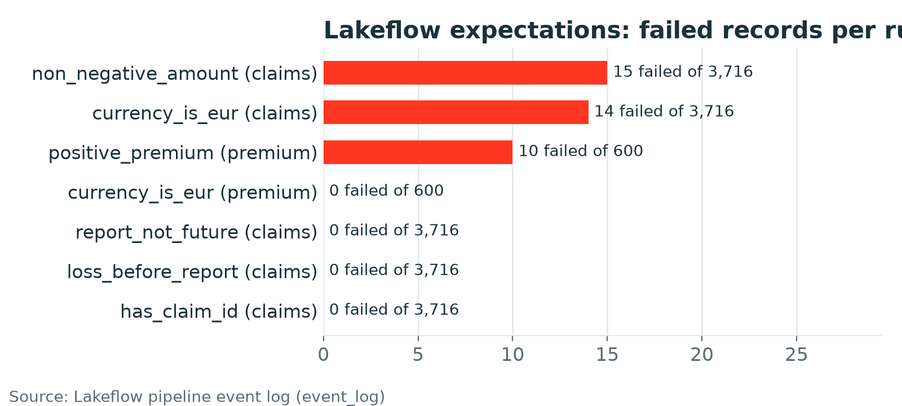
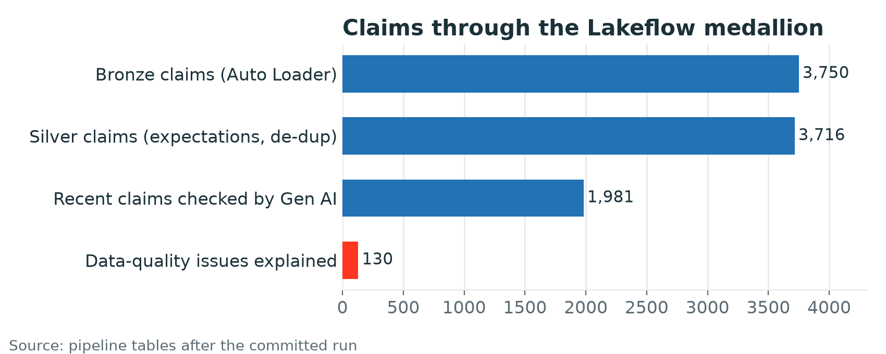
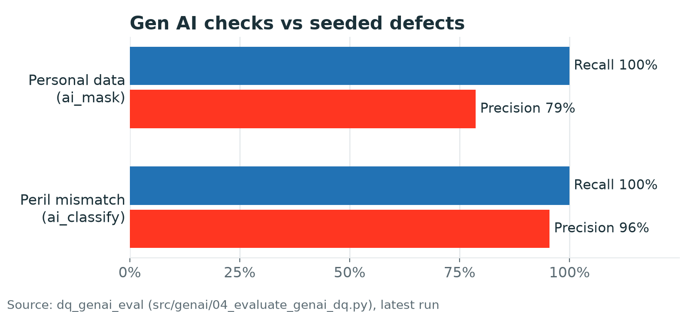
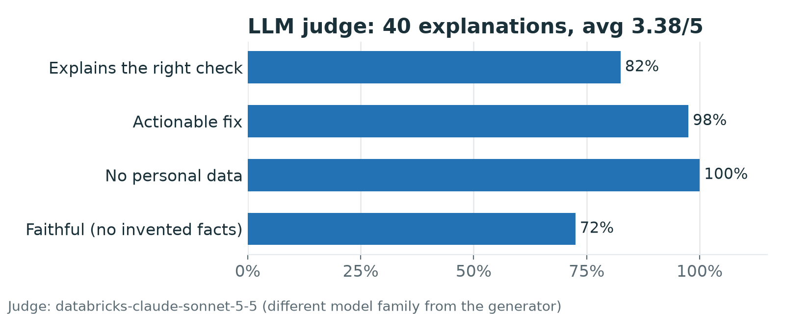
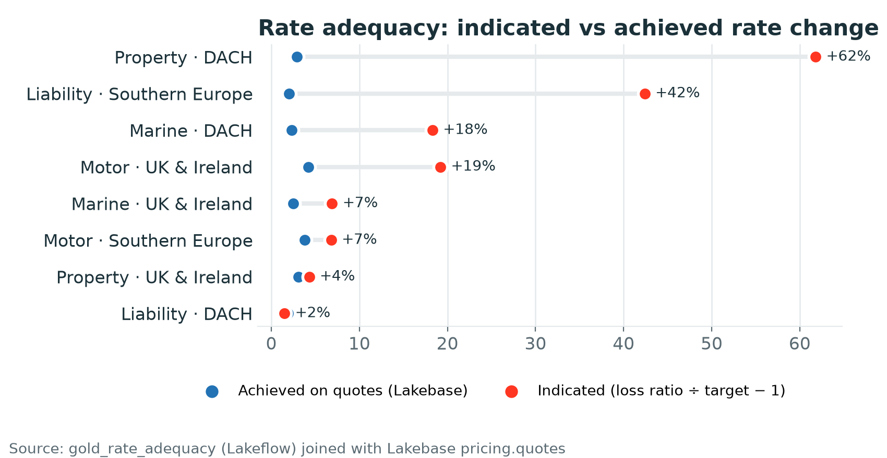
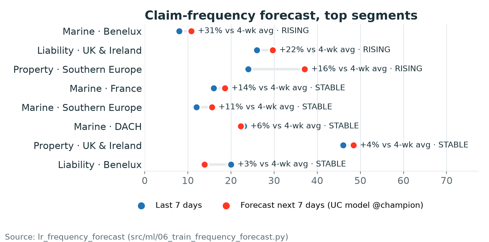
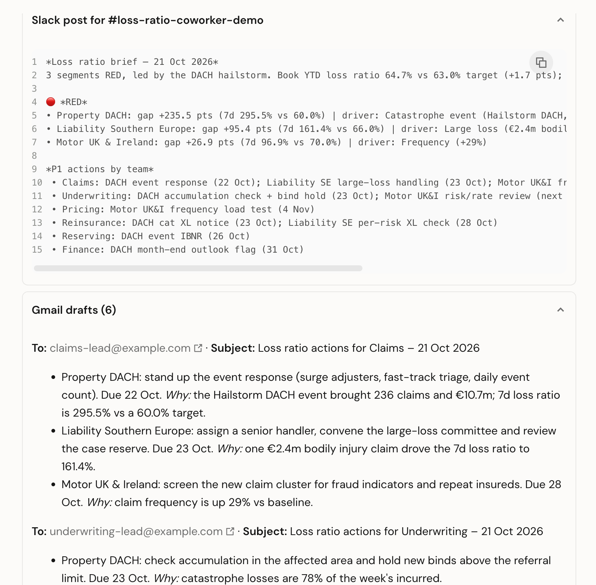

# Genie Loss Ratio Coworker

**Manage the insurance loss ratio daily, not monthly: raw claim files land in a Unity Catalog volume, a Lakeflow
pipeline cleans them with Gen AI data-quality checks, one governed loss-ratio definition feeds Genie, and the actions
it assigns live in Lakebase where teams update them through a Databricks App.**

Every weekday morning the coworker finds the segments whose loss ratio moved, explains *why* (frequency, severity,
catastrophe, large loss), recommends owned actions for Claims, Underwriting, Pricing, Reinsurance, Reserving and Finance,
posts the brief to **Slack**, and leaves each team's actions as a **Gmail draft** ready for the executive to send.
Team leads acknowledge and close their actions in the **Action Desk** app on **Lakebase**, and Pricing approves the rate
changes the coworker proposes. All data is synthetic.

## A day with the Chief Underwriting Officer

*Elena runs underwriting for a specialty commercial book (property, marine, liability, motor fleets) across five
European regions, with a bonus that rides on the combined ratio against plan. Every number below comes from the committed run.*

| Time | What Elena sees | What happens next |
|---|---|---|
| **07:30** | Slack: *"3 segments RED. Property DACH: 7-day loss ratio **266%** vs a 60% target. Driver: catastrophe (hailstorm)."* | One draft email per team is waiting in Gmail; Elena reviews and sends them |
| **07:35** | Elena asks Genie: *"Why did DACH Property jump?"* | Hail claims, a severity spike and the cat share, with the SQL; the same governed number as the dashboard and Power BI |
| **08:10** | The Reinsurance lead has a **P1 action, due in 48 hours**: notify the cat XL reinsurers | Tracked in Lakebase; the Claims lead marks the event response **IN_PROGRESS**: *"Surge adjusters deployed to Munich and Zurich; 40 hail claims triaged on day one"* |
| **09:00** | Pricing: Property DACH needs **+62%** on the loss-ratio method; quotes are achieving **+2.9%** | A rate action for Motor UK & Ireland (+7.5%) waits for approval in the Action Desk app; RED-segment quotes go to a senior underwriter |
| **11:00** | The Chief Claims Officer: **21 claims with the wrong cause code** and **70 with personal data** in the free text, found on arrival | Each has a two-sentence fix; personal data is masked before it reaches a brief or a report |
| **14:00** | The model expects **Liability UK & Ireland** claims to rise **+22%** next week, and that team's action is still OPEN | It becomes Monday's escalation |
| **17:00** | The CFO sees the hailstorm as **1.6 points** (EUR 10.1m) on the quarter's loss ratio | Event IBNR is booked this week, not explained at quarter close |

**Without the coworker,** Elena would have seen this in the month-end pack, three to six weeks later.

**Under the hood** (each moment above is built and shown running in this repo): raw claim files → **Lakeflow**
pipeline with **Gen AI** data-quality checks → one governed **Unity Catalog** definition → **Genie** explains →
**Lakebase** holds the actions teams update in a **Databricks App** → an **ML** forecast flags what's rising.

<!-- BEGIN RUN PROOF (generated by deploy/collect_run_evidence.py) -->
## Proof of execution (latest end-to-end run)

Lakeflow Job `lrc_end_to_end`, run `945039689803583`: **11/11 tasks SUCCESS**. Full evidence: [`docs/run_evidence/`](docs/run_evidence/)
(executed notebooks with outputs in [`docs/run_evidence/notebooks/`](docs/run_evidence/notebooks/), plain-text
[`job_run_log.txt`](docs/run_evidence/job_run_log.txt) and [`pipeline_event_log.txt`](docs/run_evidence/pipeline_event_log.txt)).

```text
Lakeflow Job run 945039689803583  result=SUCCESS  start=2026-11-16 05:50:41 UTC  end=2026-11-16 06:08:34 UTC

2026-11-16 05:50:41 UTC  governance_policies              notebook  SUCCESS      42s  depends_on=-
2026-11-16 05:50:41 UTC  generate_loss_run                notebook  SUCCESS      45s  depends_on=-
2026-11-16 05:50:41 UTC  lakebase_setup                   notebook  SUCCESS      37s  depends_on=-
2026-11-16 05:51:26 UTC  land_raw_files                   notebook  SUCCESS      72s  depends_on=generate_loss_run
2026-11-16 05:51:26 UTC  semantic_layer                   notebook  SUCCESS      40s  depends_on=generate_loss_run,governance_policies
2026-11-16 05:52:06 UTC  watch_and_explain                notebook  SUCCESS     554s  depends_on=semantic_layer,lakebase_setup
2026-11-16 06:01:21 UTC  lakebase_publish_and_transact    notebook  SUCCESS      27s  depends_on=watch_and_explain
2026-11-16 06:01:48 UTC  lakebase_snapshot_to_delta       notebook  SUCCESS      28s  depends_on=lakebase_publish_and_transact
2026-11-16 06:02:17 UTC  lakeflow_ingest_and_ai_dq        pipeline  SUCCESS     315s  depends_on=land_raw_files,lakebase_snapshot_to_delta,governance_policies
2026-11-16 06:02:17 UTC  train_frequency_forecast         notebook  SUCCESS      90s  depends_on=semantic_layer,lakebase_snapshot_to_delta
2026-11-16 06:07:32 UTC  evaluate_genai_dq                notebook  SUCCESS      62s  depends_on=lakeflow_ingest_and_ai_dq
```

| Result | Value |
|---|---|
| Run | `945039689803583` · **SUCCESS** · 2026-11-16 05:50:41 UTC |
| Tasks | 11/11 succeeded (notebooks + Lakeflow pipeline + Lakebase) |
| Lakeflow expectations | 7 rule results recorded · 39 records failed a rule |
| Gen AI data-quality findings | 111 (ai_classify peril mismatch, ai_mask personal data), each explained by ai_query |
| Gen AI accuracy vs seeded defects | peril_mismatch (ai_classify): precision 0.955, recall 1.0; pii_in_free_text (ai_mask): precision 0.787, recall 1.0 |
| Rule-based findings | 19 (negative amounts, loss after report, non-EUR currency) |
| Reconciliation | Lakeflow gold incurred differs from original gold by **-2.99%** over 2026-10-18 → 2026-11-16 |
| Rate adequacy | 6 segment(s) where the achieved rate change is below the indicated rate change |
| Genie Agent benchmark | 10/10 questions answered correctly from the governed tables ([06_genie_agent.md](docs/run_evidence/06_genie_agent.md)) |
| Lakebase actions | 16 actions in `ops.lr_actions` with team status |
| LLM judge of explanations | 40 explanations judged · avg score 3.38/5 · correct check 0.83 · no personal data 1.0 |
| Unity Catalog policies | 2 row filter(s) and 1 column mask(s) attached in Unity Catalog |
| ML forecast | UC model v3 scored 20 segments · 3 rising · 1 escalations (rising + Lakebase action OPEN) |

Key lines of the implementation, extracted from the committed source files:

```text
-- src/pipeline/lrc_ingest_pipeline.sql  (Lakeflow Spark Declarative Pipeline)
CREATE OR REFRESH STREAMING TABLE bronze_fnol
  ...
FROM STREAM read_files('${raw_path}/claims_fnol/', format => 'json',
  ...
CREATE OR REFRESH STREAMING TABLE bronze_premium
  ...
FROM STREAM read_files('${raw_path}/premium_bordereaux/', format => 'csv', header => true,
  ...
  loss_description STRING MASK ${policy_schema}.lrc_mask_free_text,
  ...
  CONSTRAINT has_claim_id        EXPECT (claim_id IS NOT NULL)            ON VIOLATION DROP ROW,
  CONSTRAINT report_not_future   EXPECT (report_date <= current_date())   ON VIOLATION DROP ROW,
  CONSTRAINT loss_before_report  EXPECT (loss_date <= report_date),
  CONSTRAINT non_negative_amount EXPECT (incurred_loss >= 0),
  CONSTRAINT currency_is_eur     EXPECT (currency = 'EUR')
  ...
WITH ROW FILTER ${policy_schema}.lrc_region_filter ON (region)
  ...
  CONSTRAINT positive_premium EXPECT (earned_premium > 0) ON VIOLATION DROP ROW,
  CONSTRAINT currency_is_eur  EXPECT (currency = 'EUR')
  ...
         ai_classify(loss_description, ARRAY('hail', 'fire', 'flood', 'storm or wind', 'water damage', 'theft',
  ...
         ai_mask(loss_description, ARRAY('person', 'phone number', 'email')) AS loss_description_masked
  ...
       ai_query('${llm_endpoint}',

# src/jobs/daily_loss_ratio_watch.py  (Lakebase publish + LLM judge inside the daily watch)
# MAGIC      (`ON CONFLICT DO NOTHING`, so a team's status, owner and note are never overwritten). Teams update it in the
  ...
            cur = c.execute("""INSERT INTO ops.lr_actions (action_id, alert_id, as_of_date, line_of_business, region, alert_status,
  ...
                               VALUES (%s,%s,%s,%s,%s,%s,%s,%s,%s,%s,%s) ON CONFLICT (action_id) DO NOTHING""",
  ...
  SELECT *, ai_query('{JUDGE}', concat(
  ...
judged.write.mode("append").option("mergeSchema", "true").saveAsTable(f"{FQ}.lr_explanation_judge")

# src/lakebase/01_setup_lakebase.py + 02_publish_and_transact.py  (Lakebase Postgres)
CREATE TABLE IF NOT EXISTS ops.lr_actions (
  ...
CREATE TABLE IF NOT EXISTS pricing.quotes (
  ...
CREATE TABLE IF NOT EXISTS pricing.rate_actions (
                cur.executemany("INSERT INTO pricing.quotes VALUES (%s,%s,%s,%s,%s,%s,%s,%s,%s,%s,%s) ON CONFLICT DO NOTHING", qrows)
  ...
            cur = c.execute("""INSERT INTO pricing.rate_actions (rate_action_id, source_action_id, line_of_business, region,
  ...
    st = w.database.create_synced_database_table(SyncedDatabaseTable(

# src/ml/06_train_frequency_forecast.py  (trained model, registered in Unity Catalog)
    model = HistGradientBoostingRegressor(max_iter=300, learning_rate=0.05, max_leaf_nodes=15, random_state=7)
    model.fit(X_tr, y_tr)
  ...
    mae_model = mean_absolute_error(y_te, pred)
    mae_naive = mean_absolute_error(y_te, X_te["c7"])
  ...
    info = mlflow.sklearn.log_model(model, "model", signature=infer_signature(X_tr, model.predict(X_tr.head(5))),
  ...
    client.set_registered_model_alias(MODEL, "champion", version)
  ...
champion = mlflow.sklearn.load_model(f"models:/{MODEL}@champion")

# databricks.yml  (Lakeflow Job + pipeline + Lakebase instance + app, as code)
  database_instances:
  ...
  pipelines:
  ...
  apps:
  ...
  jobs:
  ...
        - task_key: governance_policies          # UC row filter + column mask functions
  ...
        - task_key: generate_loss_run            # synthetic book with three seeded events
  ...
        - task_key: lakebase_setup               # Postgres schemas ops + pricing, seeded quotes
  ...
        - task_key: semantic_layer               # gold, metric views, Ontology, row filter on gold
          depends_on: [{task_key: generate_loss_run}, {task_key: governance_policies}]
  ...
        - task_key: land_raw_files               # FNOL JSON + bordereaux CSV into the raw UC volume
          depends_on: [{task_key: generate_loss_run}]
  ...
        - task_key: watch_and_explain            # detect → Genie why → playbook → Lakebase publish → LLM judge
          depends_on: [{task_key: semantic_layer}, {task_key: lakebase_setup}]
  ...
        - task_key: lakebase_publish_and_transact   # quotes, rate actions, synced table, app grants
          depends_on: [{task_key: watch_and_explain}]
  ...
        - task_key: lakebase_snapshot_to_delta   # Postgres → Delta for Genie and Lakeflow
          depends_on: [{task_key: lakebase_publish_and_transact}]
  ...
        - task_key: lakeflow_ingest_and_ai_dq    # the Lakeflow Spark Declarative Pipeline
          depends_on: [{task_key: land_raw_files}, {task_key: lakebase_snapshot_to_delta}, {task_key: governance_policies}]
          pipeline_task:
  ...
        - task_key: evaluate_genai_dq            # precision/recall vs seeded defects + LLM judge
          depends_on: [{task_key: lakeflow_ingest_and_ai_dq}]
  ...
        - task_key: train_frequency_forecast     # ML model in UC registry + Lakebase status escalations
          depends_on: [{task_key: semantic_layer}, {task_key: lakebase_snapshot_to_delta}]
  ...
        - task_key: generate_loss_run
  ...
        - task_key: semantic_layer
          depends_on: [{task_key: generate_loss_run}]
  ...
        - task_key: refresh_loss_run
  ...
        - task_key: refresh_semantic_layer
          depends_on: [{task_key: refresh_loss_run}]
  ...
        - task_key: watch_and_notify
          depends_on: [{task_key: refresh_semantic_layer}]
```
<!-- END RUN PROOF -->


**Build and AI mindset (workflow, trade-offs, verbatim run output):** [`docs/BUILD_AND_AI_MINDSET.md`](docs/BUILD_AND_AI_MINDSET.md) · **Read next:** [Solution summary: story, components and the script for every step](docs/SOLUTION.md) ·
[Run evidence from a real run](docs/run_evidence/README.md)

## For reviewers: where each layer is implemented and shown running

| Layer | Implementation (code) | Execution evidence (committed output) |
|---|---|---|
| **Lakeflow pipeline** (Auto Loader, expectations, materialized views) | [`src/pipeline/lrc_ingest_pipeline.sql`](https://github.com/sas2106-data/genie-loss-ratio-coworker/blob/main/src/pipeline/lrc_ingest_pipeline.sql) · [`databricks.yml`](https://github.com/sas2106-data/genie-loss-ratio-coworker/blob/main/databricks.yml) | [`pipeline_event_log.txt`](https://github.com/sas2106-data/genie-loss-ratio-coworker/blob/main/docs/run_evidence/pipeline_event_log.txt) · [`03_lakeflow_pipeline.md`](https://github.com/sas2106-data/genie-loss-ratio-coworker/blob/main/docs/run_evidence/03_lakeflow_pipeline.md) |
| **Lakeflow Job** (bundle job, 11 tasks) | [`databricks.yml`](https://github.com/sas2106-data/genie-loss-ratio-coworker/blob/main/databricks.yml) · [`databricks.yml`](https://github.com/sas2106-data/genie-loss-ratio-coworker/blob/main/databricks.yml) | [`job_run_log.txt`](https://github.com/sas2106-data/genie-loss-ratio-coworker/blob/main/docs/run_evidence/job_run_log.txt) · [`01_job_run.md`](https://github.com/sas2106-data/genie-loss-ratio-coworker/blob/main/docs/run_evidence/01_job_run.md) |
| **Gen AI data quality** (`ai_classify`, `ai_mask`, `ai_query`) | [`src/pipeline/lrc_ingest_pipeline.sql`](https://github.com/sas2106-data/genie-loss-ratio-coworker/blob/main/src/pipeline/lrc_ingest_pipeline.sql) (`silver_claims_ai_checked`, `dq_claims_issues`) | [`04_query_results.md`](https://github.com/sas2106-data/genie-loss-ratio-coworker/blob/main/docs/run_evidence/04_query_results.md) · [`csv/dq_genai_examples.csv`](https://github.com/sas2106-data/genie-loss-ratio-coworker/blob/main/docs/run_evidence/csv/dq_genai_examples.csv) |
| **Gen AI evaluation** (precision/recall + LLM judge) | [`src/genai/04_evaluate_genai_dq.py`](https://github.com/sas2106-data/genie-loss-ratio-coworker/blob/main/src/genai/04_evaluate_genai_dq.py) | [`07_genai_quality.md`](https://github.com/sas2106-data/genie-loss-ratio-coworker/blob/main/docs/run_evidence/07_genai_quality.md) · [executed notebook](https://github.com/sas2106-data/genie-loss-ratio-coworker/blob/main/docs/run_evidence/notebooks/) |
| **Lakebase** (Postgres: actions, team status, quotes, rate actions, synced table) | [`src/lakebase/01_setup_lakebase.py`](https://github.com/sas2106-data/genie-loss-ratio-coworker/blob/main/src/lakebase/01_setup_lakebase.py) · [`02_publish_and_transact.py`](https://github.com/sas2106-data/genie-loss-ratio-coworker/blob/main/src/lakebase/02_publish_and_transact.py) · [`03_snapshot_to_delta.py`](https://github.com/sas2106-data/genie-loss-ratio-coworker/blob/main/src/lakebase/03_snapshot_to_delta.py) · [`databricks.yml`](https://github.com/sas2106-data/genie-loss-ratio-coworker/blob/main/databricks.yml) | [`05_lakebase.md`](https://github.com/sas2106-data/genie-loss-ratio-coworker/blob/main/docs/run_evidence/05_lakebase.md) · [executed notebooks](https://github.com/sas2106-data/genie-loss-ratio-coworker/blob/main/docs/run_evidence/notebooks/) |
| **App on Lakebase** (Streamlit Databricks App) | [`app/action_desk/app.py`](https://github.com/sas2106-data/genie-loss-ratio-coworker/blob/main/app/action_desk/app.py) · [`databricks.yml`](https://github.com/sas2106-data/genie-loss-ratio-coworker/blob/main/databricks.yml) | [`action_desk.png`](https://github.com/sas2106-data/genie-loss-ratio-coworker/blob/main/docs/run_evidence/action_desk.png) |
| **Unity Catalog governance** (row filter, column mask, metric views) | [`src/governance/05_row_filter_column_mask.py`](https://github.com/sas2106-data/genie-loss-ratio-coworker/blob/main/src/governance/05_row_filter_column_mask.py) · [`src/setup/02_semantic_layer.py`](https://github.com/sas2106-data/genie-loss-ratio-coworker/blob/main/src/setup/02_semantic_layer.py) | [`08_governance.md`](https://github.com/sas2106-data/genie-loss-ratio-coworker/blob/main/docs/run_evidence/08_governance.md) |
| **ML model** (frequency forecast in UC registry) | [`src/ml/06_train_frequency_forecast.py`](https://github.com/sas2106-data/genie-loss-ratio-coworker/blob/main/src/ml/06_train_frequency_forecast.py) | [`09_ml_forecast.md`](https://github.com/sas2106-data/genie-loss-ratio-coworker/blob/main/docs/run_evidence/09_ml_forecast.md) |
| **Genie Agent** (live answers, benchmark) | [`deploy/genie_agent.py`](https://github.com/sas2106-data/genie-loss-ratio-coworker/blob/main/deploy/genie_agent.py) · [`deploy/genie_benchmark.py`](https://github.com/sas2106-data/genie-loss-ratio-coworker/blob/main/deploy/genie_benchmark.py) | [`06_genie_agent.md`](https://github.com/sas2106-data/genie-loss-ratio-coworker/blob/main/docs/run_evidence/06_genie_agent.md) |
| **Executed notebooks with cell outputs** | every notebook task of the job run | [`docs/run_evidence/notebooks/*.ipynb`](https://github.com/sas2106-data/genie-loss-ratio-coworker/blob/main/docs/run_evidence/notebooks/) |

Headline results of the committed run: [`docs/run_evidence/README.md`](https://github.com/sas2106-data/genie-loss-ratio-coworker/blob/main/docs/run_evidence/README.md).

### Results of the committed run, as charts

Generated from the committed CSVs by [`deploy/make_charts.py`](deploy/make_charts.py); numbers and tables in
[`docs/run_evidence/README.md`](docs/run_evidence/README.md).

| Lakeflow expectations (event log) | Claims through the medallion |
|---|---|
|  |  |
| **Gen AI checks vs seeded defects** | **LLM judge of the ai_query explanations** |
|  |  |
| **Rate adequacy (Lakeflow gold + Lakebase quotes)** | **Claim-frequency forecast (UC model)** |
|  |  |

### The core code, inline

**Lakeflow: Auto Loader bronze, expectations and Unity Catalog policies in silver** (`src/pipeline/lrc_ingest_pipeline.sql`)

```sql
CREATE OR REFRESH STREAMING TABLE bronze_fnol
AS SELECT *, _metadata.file_path AS source_file, current_timestamp() AS ingested_at
FROM STREAM read_files('${raw_path}/claims_fnol/', format => 'json', schemaHints => '...');

CREATE OR REFRESH MATERIALIZED VIEW silver_claims (
  ..., loss_description STRING MASK ${policy_schema}.lrc_mask_free_text, ...,
  CONSTRAINT has_claim_id        EXPECT (claim_id IS NOT NULL)          ON VIOLATION DROP ROW,
  CONSTRAINT report_not_future   EXPECT (report_date <= current_date()) ON VIOLATION DROP ROW,
  CONSTRAINT non_negative_amount EXPECT (incurred_loss >= 0),
  CONSTRAINT currency_is_eur     EXPECT (currency = 'EUR')
)
WITH ROW FILTER ${policy_schema}.lrc_region_filter ON (region)
AS SELECT ... FROM bronze_fnol
QUALIFY ROW_NUMBER() OVER (PARTITION BY claim_id ORDER BY ingested_at DESC, source_file DESC) = 1;
```

**Gen AI data quality inside the pipeline** (same file)

```sql
CREATE OR REFRESH MATERIALIZED VIEW silver_claims_ai_checked AS
WITH ai AS (
  SELECT *,
         ai_classify(loss_description, ARRAY('hail', 'fire', 'flood', 'storm or wind', 'water damage', 'theft', ...)) AS ai_peril,
         ai_mask(loss_description, ARRAY('person', 'phone number', 'email'))                            AS loss_description_masked
  FROM recent)
SELECT * EXCEPT (loss_description), CASE ai_peril WHEN 'hail' THEN cause_of_loss IN ('Hail', 'Weather') ... END AS peril_consistent,
       loss_description_masked <> loss_description AS pii_detected
FROM ai;

CREATE OR REFRESH MATERIALIZED VIEW dq_claims_issues AS
SELECT *, ai_query('${llm_endpoint}', concat('You are a claims data-quality analyst ... Check failed: ', check_name, ...)) AS ai_explanation
FROM issues;
```

**Lakebase: operational tables and an idempotent transaction** (`src/lakebase/01_setup_lakebase.py`, `02_publish_and_transact.py`)

```python
cred = w.database.generate_database_credential(request_id=str(uuid.uuid4()), instance_names=[instance.name])
conn = psycopg.connect(host=instance.read_write_dns, dbname="lrc_ops", user=ME, password=cred.token, sslmode="require")
# CREATE TABLE ops.lr_actions (action_id TEXT PRIMARY KEY, ..., status TEXT CHECK (status IN ('OPEN','ACKNOWLEDGED','IN_PROGRESS','DONE')), owner TEXT, note TEXT, ...)
with conn.transaction():
    c.execute("INSERT INTO ops.lr_actions (...) VALUES (...) ON CONFLICT (action_id) DO NOTHING", ...)      # keep team edits
    cur.executemany("INSERT INTO pricing.quotes VALUES (...) ON CONFLICT DO NOTHING", quotes)              # pricing desk
    c.execute("INSERT INTO pricing.rate_actions (...) VALUES (...) ON CONFLICT (source_action_id) DO NOTHING", ...)
w.database.create_synced_database_table(SyncedDatabaseTable(name=f"{CATALOG}.{SCHEMA}.lr_watchlist_serving",
    database_instance_name=INSTANCE, logical_database_name=DB,
    spec=SyncedTableSpec(source_table_full_name=f"{CATALOG}.{SCHEMA}.lr_watchlist_snapshot",
                         primary_key_columns=["line_of_business", "region"], scheduling_policy=SyncedTableSchedulingPolicy.SNAPSHOT)))
```

**Lakeflow Job orchestration** (`databricks.yml`, excerpt)

```yaml
lrc_end_to_end:
  tasks:
    - task_key: land_raw_files          # notebook: synthetic files → UC volume
    - task_key: lakebase_publish_and_transact
      depends_on: [{task_key: watch_and_explain}, {task_key: lakebase_setup}]
    - task_key: lakeflow_ingest_and_ai_dq
      depends_on: [{task_key: land_raw_files}, {task_key: lakebase_snapshot_to_delta}, {task_key: governance_policies}]
      pipeline_task: {pipeline_id: ${resources.pipelines.lrc_ingest.id}}
    - task_key: evaluate_genai_dq
      depends_on: [{task_key: lakeflow_ingest_and_ai_dq}]
    - task_key: train_frequency_forecast
      depends_on: [{task_key: semantic_layer}, {task_key: lakebase_snapshot_to_delta}]
```

## Solution summary

| Capability | What it does | Script |
|---|---|---|
| Raw landing | Claim FNOL (JSON) and premium bordereaux (CSV) land in a UC volume, with seeded defects | [`src/raw/03_land_raw_files.py`](src/raw/03_land_raw_files.py) |
| **Lakeflow ETL** | Auto Loader bronze → silver with expectations and de-dup → gold loss run and rate adequacy (serverless SDP) | [`src/pipeline/lrc_ingest_pipeline.sql`](src/pipeline/lrc_ingest_pipeline.sql), [`databricks.yml`](databricks.yml) |
| **Gen AI data quality** | `ai_classify` peril vs coded cause, `ai_mask` personal data, `ai_query` explanation and fix, inside the pipeline | [`src/pipeline/lrc_ingest_pipeline.sql`](src/pipeline/lrc_ingest_pipeline.sql) (`silver_claims_ai_checked`, `dq_claims_issues`, `dq_daily_scorecard`) |
| Gen AI evaluation | Precision and recall against the seeded defects, plus an LLM judge (different model family) of the explanations, every run | [`src/genai/04_evaluate_genai_dq.py`](src/genai/04_evaluate_genai_dq.py) |
| UC governance | Row filter by region and column mask on claim free text, attached by the pipeline | [`src/governance/05_row_filter_column_mask.py`](src/governance/05_row_filter_column_mask.py) |
| ML forecast | Next-7-day claim-frequency model registered in Unity Catalog; escalates when rising and the Lakebase action is still OPEN | [`src/ml/06_train_frequency_forecast.py`](src/ml/06_train_frequency_forecast.py) |
| Semantic layer | Metric views, Genie Ontology, targets, watchlist | [`src/setup/02_semantic_layer.py`](src/setup/02_semantic_layer.py) |
| Detect and explain | RED/AMBER detection, Genie Agent *why*, action playbook | [`src/jobs/daily_loss_ratio_watch.py`](src/jobs/daily_loss_ratio_watch.py) |
| **Lakebase** setup | Instance, database, `ops` and `pricing` schemas, seeded quotes | [`src/lakebase/01_setup_lakebase.py`](src/lakebase/01_setup_lakebase.py), [`_lakebase_conn.py`](src/lakebase/_lakebase_conn.py), [`databricks.yml`](databricks.yml) |
| **Lakebase** transactions | Publish actions, record quotes and referrals, propose rate actions, synced watchlist table | [`src/lakebase/02_publish_and_transact.py`](src/lakebase/02_publish_and_transact.py) |
| **Lakebase** → Delta | Team status and pricing snapshotted back for Genie and Lakeflow | [`src/lakebase/03_snapshot_to_delta.py`](src/lakebase/03_snapshot_to_delta.py) |
| Action Desk app | Teams update status, owner, note; Pricing approves rate actions (Postgres transactions) | [`app/action_desk/app.py`](app/action_desk/app.py), [`databricks.yml`](databricks.yml) |
| Orchestration | One Lakeflow Job runs every step; one bundle deploys everything | [`databricks.yml`](databricks.yml) (`lrc_end_to_end`), [`databricks.yml`](databricks.yml) |
| Genie Agent, dashboard, Genie One | Explain, answer, brief, Slack post, Gmail drafts | [`deploy/genie_agent.py`](deploy/genie_agent.py), [`deploy/dashboard.py`](deploy/dashboard.py), [`skills/loss-ratio-daily-brief.md`](skills/loss-ratio-daily-brief.md) |
| Genie Agent benchmark | Asks the deployed agent CUO questions, scores against ground-truth SQL (10/10) | [`deploy/genie_benchmark.py`](deploy/genie_benchmark.py) → [`docs/run_evidence/06_genie_agent.md`](docs/run_evidence/06_genie_agent.md) |
| Charts | Run results as charts from the committed CSVs | [`deploy/make_charts.py`](deploy/make_charts.py) → [`docs/charts/`](docs/charts/) |
| Run evidence | Job run, notebook outputs, pipeline expectations, query results, Lakebase state, committed as Markdown + CSV | [`deploy/collect_run_evidence.py`](deploy/collect_run_evidence.py) → [`docs/run_evidence/`](docs/run_evidence/) |

The original Genie One flow is still in [`docs/diagrams/flow.png`](docs/diagrams/flow.png).

---

## For executives: what changes

| Moment | Today | With the coworker |
|---|---|---|
| 07:30 | Nothing on loss ratio until the month-end pack | Genie One posts the brief in Slack: what's RED, why, who's acting |
| Exec meeting | "Why is Property up?" becomes an analyst ticket | `@Genie why did DACH Property jump?` is answered in the meeting, with the SQL |
| Reinsurance | Hears about the event at month-end | Has a P1 action with a 48-hour due date the same morning |
| Follow-up | Writes six emails to team leads | Opens Gmail: six drafts, one per team, with actions, due dates and the why. Review, send |
| Board pack | Debates whose loss ratio is right | One governed number, next to the AM Best and Global Insurance Customer benchmarks |

Context: the US P&C industry combined ratio was **92.9% in FY2025** (AM Best, 96.6% in FY2024); a Global Insurance Customer reported a
**90.6%** P&C combined ratio for FY2025 (94.1% undiscounted). In a market this tight, a few points of loss ratio decide
the year, and they move between month-ends.

| Morning brief (Genie One skill) | Recommended actions (dashboard) |
|---|---|
|  |  |

| Genie One writes the Slack post + Gmail drafts | Genie One explains the RED segments |
|---|---|
|  |  |

More: [dashboard](docs/screenshots/01_dashboard.png) · [skill in Genie One](docs/screenshots/05_skill_invoke.png) ·
[actions by team](docs/screenshots/07_brief_actions_by_team.png) · [scheduled task](docs/screenshots/08_scheduled_task.png) ·
[Gmail drafts](docs/screenshots/11_genie_one_gmail_drafts.png)

---

## For builders: what's in the repo

| Path | What it is |
|---|---|
| `src/setup/01_generate_loss_run.py` | Synthetic European commercial P&C book (150k policies, ~77k claims, daily earned premium) with three seeded events: a DACH hailstorm, a UK motor frequency creep and a EUR 2.4m bodily-injury loss |
| `src/setup/02_semantic_layer.py` | Gold daily loss run, targets/thresholds/owners, public benchmarks, **metric views** `mv_loss_ratio` and `mv_loss_run` (YAML 1.1 with display names, synonyms and formats), the RAG watchlist, alert tables, comments and tags for **Genie Ontology** |
| `src/jobs/daily_loss_ratio_watch.py` | Daily job: detect RED/AMBER → ask the Genie Agent *why* → action playbook per team → Delta audit trail → Slack Block Kit and Teams Adaptive Card |
| `deploy/genie_agent.py` | Creates the **Loss Ratio Coworker** Genie Agent (tables, instructions, example SQL, sample questions) |
| `deploy/dashboard.py` | Creates and publishes the **Daily Loss Ratio Watch** AI/BI dashboard |
| `skills/loss-ratio-daily-brief.md` | The **Genie One skill**: brief → Slack post → one Gmail draft per team, and how to schedule it |
| `src/raw/03_land_raw_files.py` | Lands synthetic claim FNOL files (JSON) and premium bordereaux (CSV) in the `raw` volume, with seeded data-quality defects |
| `src/pipeline/lrc_ingest_pipeline.sql` | **Lakeflow Spark Declarative Pipeline**: Auto Loader bronze, silver with expectations, **Gen AI data quality** (`ai_classify`, `ai_mask`, `ai_query`), gold loss run, DQ scorecard, rate adequacy |
| `src/genai/04_evaluate_genai_dq.py` | Scores the Gen AI checks against the seeded defects (precision, recall, F1) and runs an LLM judge on the explanations |
| `src/governance/05_row_filter_column_mask.py` | Unity Catalog row filter (region) and column mask (claim free text) used by the pipeline |
| `src/ml/06_train_frequency_forecast.py` | Claim-frequency forecast: train, compare with naive baseline, register in UC, score, escalate with Lakebase status |
| `src/lakebase/01–03_*.py` | **Lakebase**: setup (`ops`, `pricing`), publish actions + pricing transactions + synced table, snapshot back to Delta |
| `app/action_desk/` | **Databricks App** on Lakebase: team status updates and rate-action approvals |

| `deploy/collect_run_evidence.py` | Writes readable run evidence to `docs/run_evidence/` |
| `docs/SOLUTION.md` | Solution summary: story, why each component, every step and its script |
| `docs/run_evidence/` | Committed output of a real end-to-end run |
| `docs/APPROACH.md` | Detailed design: problem, principles, detection logic, playbook, governance, 6-week rollout, risks |
| `docs/CONNECT_SLACK_TEAMS_GMAIL_OUTLOOK.md` | Step-by-step setup for Slack, Microsoft Teams, Gmail and Outlook: Genie One connectors, the Genie apps, the webhook job, a checklist and troubleshooting |
| `docs/article/linkedin_article.md` | The accompanying article |

### Quick start

Prerequisites: a Unity Catalog workspace with serverless compute and a serverless SQL warehouse, Genie One enabled,
the Databricks CLI.

```bash
export DATABRICKS_CONFIG_PROFILE=<profile>
export LRC_CATALOG=<catalog> LRC_WAREHOUSE_ID=<warehouse-id>

# 1. Deploy the jobs, then build the data and semantic layer
databricks bundle deploy --var catalog=$LRC_CATALOG --var warehouse_id=$LRC_WAREHOUSE_ID
databricks bundle run lrc_setup --var catalog=$LRC_CATALOG --var warehouse_id=$LRC_WAREHOUSE_ID

# 2. Genie Agent and dashboard
python deploy/genie_agent.py        # prints GENIE_SPACE_ID=...
python deploy/dashboard.py

# 3. Redeploy with the agent id and run the daily watch (dry run)
databricks bundle deploy --var catalog=$LRC_CATALOG --var warehouse_id=$LRC_WAREHOUSE_ID --var genie_space_id=<id>
databricks bundle run lrc_daily_watch --var catalog=$LRC_CATALOG --var warehouse_id=$LRC_WAREHOUSE_ID --var genie_space_id=<id>
```

End-to-end scenario (Lakeflow, Gen AI data quality, Lakebase, Action Desk app):

```bash
# 4. One job runs every step: generate → land raw files → watch → Lakebase → snapshot → UC policies → Lakeflow pipeline → Gen AI eval → ML forecast
databricks bundle run lrc_end_to_end --var catalog=$LRC_CATALOG --var warehouse_id=$LRC_WAREHOUSE_ID --var genie_space_id=<id>

# 5. The app needs the Lakebase database from step 4: redeploy, then start it
databricks bundle deploy --var catalog=$LRC_CATALOG --var warehouse_id=$LRC_WAREHOUSE_ID --var genie_space_id=<id>
databricks bundle run lrc_action_desk --var catalog=$LRC_CATALOG --var warehouse_id=$LRC_WAREHOUSE_ID --var genie_space_id=<id>

# 6. Refresh the Genie Agent with the new tables and commit the run evidence
python deploy/genie_agent.py
python deploy/collect_run_evidence.py
```

Then in Genie One: connect **Slack** and **Gmail** or **Microsoft 365** (for Outlook), create the skill from
`skills/loss-ratio-daily-brief.md`, run `/loss-ratio-daily-brief`, and ask *"Schedule this every weekday at 07:30"*.
For Slack, Microsoft Teams, Gmail and Outlook setup (connectors, the Genie apps, webhooks, write-tool enablement and
troubleshooting) follow [`docs/CONNECT_SLACK_TEAMS_GMAIL_OUTLOOK.md`](docs/CONNECT_SLACK_TEAMS_GMAIL_OUTLOOK.md).

### Design notes

- **One definition.** Loss ratio = incurred ÷ earned, defined once in a metric view; every surface reads it.
- **Deterministic detection.** Thresholds (per line, in `lr_targets`) and the playbook are rules; Genie explains, it doesn't decide.
- **Context matters.** Genie One searches every Genie asset you can see. Name the agent in the skill, or pin it to a
  Slack/Teams channel, so loss-ratio questions stay on the governed agent.
- **Human on the send button.** The Gmail connector drafts but cannot send; the executive reviews every instruction.
- **Governance.** Genie One, its connectors and Genie Agents run with the user's Unity Catalog permissions through Unity
  Gateway. Connector write tools start read-only and are enabled per workspace by an admin.
- **Status.** The Genie apps for Slack and Teams are Public Preview and skill sharing is Beta at the time of writing.

### Sources

- AM Best, *US Property/Casualty 2025 Financial Results*: <https://www.ambest.com/bestlink/IndustryReports/pcssaft1new.pdf>
- Databricks docs: [Genie One in Slack](https://docs.databricks.com/aws/en/genie-one/genie-slack) ·
  [Genie in Microsoft Teams](https://docs.databricks.com/aws/en/integrations/msft-teams) ·
  [Genie One connectors](https://docs.databricks.com/aws/en/genie-one/external-sources) ·
  [Genie Ontology](https://docs.databricks.com/aws/en/genie/genie-ontology) ·
  [Metric views](https://docs.databricks.com/aws/en/uc-semantics/metric-views/)

*Synthetic data only. Global Insurance Customer and AM Best figures are public and used as market context, not as targets. Not an official
Databricks product.*
