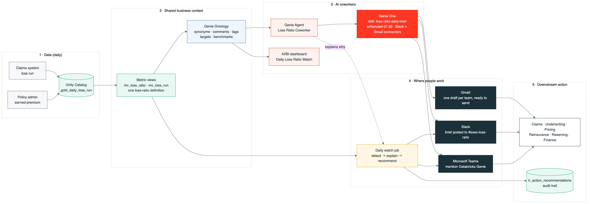

# Approach: managing the loss ratio daily with an AI coworker

This document is the detailed design behind the repo. It is written for the CUO/CFO office, the data and AI team, and
the teams that act on loss-ratio signals.

---

## 1. Problem

The loss ratio (incurred loss ÷ earned premium) is the single most important number in P&C underwriting, yet most
carriers see it **monthly or quarterly**, through a slide built by an analyst. By then:

- a hailstorm's claims have been reported for three weeks without a reinsurance notification,
- a creeping rise in motor collision frequency has already been renewed into next year's book,
- a single large bodily-injury loss has distorted the month and triggered the wrong conversation.

The market context makes this sharper. The US P&C industry ran a **92.9% combined ratio in FY2025** (AM Best), down from
96.6% in 2024. A Global Insurance Customer reported a **90.6% P&C combined ratio for FY2025** (94.1% undiscounted). In a market this profitable,
the gap between a good and an average year is a few points of loss ratio. Those points are won or lost in the weeks
between month-ends.

## 2. Goal and success measures

**Goal:** every morning, the right person sees which segments moved, why, and what to do, and can ask a follow-up in
the tools they already use, with the same governed number everywhere.

| Measure | Before (typical) | Target |
|---|---|---|
| Time from loss reported to the exec seeing the segment move | 3–6 weeks (month-end pack) | < 24 hours |
| Definitions of "loss ratio" in circulation | several (paid vs incurred, written vs earned) | 1 (metric view) |
| Time from signal to an owned action | ad hoc | same morning, owner and due date assigned |
| Analyst hours on the monthly loss-ratio pack | days | review only |

## 3. Design principles

1. **One definition, everywhere.** Loss ratio lives once, in a Unity Catalog metric view. The dashboard, Genie Agent,
   Genie One and the alert job all call it. Nobody recomputes it.
2. **Context before chat.** Accuracy comes from business context (definitions, synonyms, targets, owners, benchmarks),
   not from a cleverer prompt. Genie Ontology picks this context up from Unity Catalog.
3. **Deterministic where it matters.** Detection thresholds and the action playbook are rules in code and tables, so
   every alert and recommendation can be explained to an auditor. Genie explains *why*; it does not decide *whether*.
4. **Meet people where they work.** Executives live in Slack, Teams and email. The answer goes there, and the follow-up
   question can be asked there.
5. **Governed by default.** Every question runs with the asker's Unity Catalog permissions. Alerts and actions are
   written to Delta as an audit trail.

## 4. Architecture



| Layer | Component | In this repo |
|---|---|---|
| Data | Daily loss run (claims by report date) and earned premium per day | `src/setup/01_generate_loss_run.py` (synthetic) |
| Gold | `gold_daily_loss_run` (day × line of business × region) | `src/setup/02_semantic_layer.py` |
| Semantics | Metric views `mv_loss_ratio`, `mv_loss_run` (YAML 1.1 with display names, synonyms, formats) | same |
| Context | `lr_targets` (plan, thresholds, owner team), `industry_benchmarks` (AM Best, Global Insurance Customer), comments, tags | same |
| Watch | `v_loss_ratio_watchlist`: 7-day, 30-day and YTD loss ratio, frequency vs severity, RAG status, driver | same |
| Agent | Genie Agent *Loss Ratio Coworker* on the metric views, with instructions and example SQL | `deploy/genie_agent.py` |
| Dashboard | AI/BI dashboard *Daily Loss Ratio Watch* | `deploy/dashboard.py` |
| Coworker | Genie One skill `/loss-ratio-daily-brief` + scheduled task; Genie apps for Slack and Teams | `skills/`, `docs/CONNECT_SLACK_TEAMS_GMAIL_OUTLOOK.md` |
| Automation | Daily job: detect → explain (Genie) → recommend (playbook) → record → notify | `src/jobs/daily_loss_ratio_watch.py` |
| Delivery | Genie One **Slack** connector posts the brief; **Gmail** connector creates one draft per team (never sends) | `skills/` |

## 5. Detection logic

For every line of business × region, each morning:

| Signal | Definition |
|---|---|
| 7-day loss ratio | incurred reported in the last 7 days ÷ earned premium in the same days |
| 30-day and YTD loss ratio | same, over 30 days and the calendar year |
| Frequency change | claims per EUR 1m earned, last 7 days vs the prior 90 days |
| Severity change | incurred per claim, last 7 days vs the prior 90 days |
| Large losses | claims ≥ EUR 250k reported in the last 7 days |
| Cat share | share of 7-day incurred tagged to a catastrophe event |

**Status:** RED if the 7-day gap to target ≥ `red_pts` *or* the 30-day gap ≥ 60% of `red_pts`; AMBER if the 7-day gap ≥
`amber_pts`; otherwise GREEN. Thresholds are per line of business in `lr_targets` (Marine is wider because it is more
volatile).

**Driver** (first match wins): catastrophe event (cat share ≥ 50%) → large loss (a large loss and severity > 1.5× base)
→ frequency (+25%) → severity (+25%) → within normal variation.

Why 7 and 30 days: the 7-day window catches events fast; the 30-day window stops a slow creep from hiding under the
weekly noise. Exposure-weighting by earned premium keeps small segments from dominating.

## 6. From signal to action: the playbook

| Driver | Team | Recommended action | Due |
|---|---|---|---|
| Catastrophe event | Claims | Event response: surge adjusters, fast-track triage, daily event count | 24h |
| | Reinsurance | Notify cat XL reinsurers, estimate recovery vs retention | 48h |
| | Reserving | Book event IBNR for the month-end | 5 days |
| | Underwriting | Check accumulation, hold new binds above referral limit | 48h |
| | Finance | Flag gross and net impact in the month-end outlook | Month-end |
| Frequency | Underwriting | Review risk selection and rate adequacy at renewal; broker mix | Next renewals |
| | Pricing | Test the trend in the rating model; frequency load if it persists | 2 weeks |
| | Claims | Screen the new-claim cluster for fraud indicators | 1 week |
| Large loss | Claims | Senior handler, large-loss committee, reserve review | 48h |
| | Reinsurance | Check per-risk XL attachment, notify | 1 week |
| | Underwriting | Review the account and similar risks before renewal | Before renewal |
| Severity | Claims | Analyse repair, supplier and legal cost inflation | 2 weeks |
| | Pricing | Refresh severity trend assumptions | Next review |

Actions are written to `lr_action_recommendations` with priority (P1 for RED), owner team and state, so they can be
tracked, reported on and asked about ("@Genie what is still open for Reinsurance?").

## 7. How it makes an executive's life easier

| Moment | Before | With the coworker |
|---|---|---|
| 07:30 | Opens email, nothing on loss ratio until month-end | Genie One brief in Slack/Teams: 3 RED segments, why, who is acting |
| 08:00 exec meeting | "Do we know why Property is up?" Analyst request raised | `@Genie why did DACH Property jump?` → hail, 236 claims, cat share 78%, answered in the meeting |
| 09:00 | Reinsurance learns about the event at month-end | Reinsurance already has a P1 action with a 48h due date |
| 08:15 | Writes follow-up emails to six team leads | Opens Gmail: six drafts with actions, due dates and the why; reviews and sends |
| Board pack | Debate about whose loss ratio is right | One governed number, with the benchmark source next to it |

## 8. Governance and controls

- **Permissions:** Genie One, its connectors and the Genie Agent run with the user's Unity Catalog permissions through
  Unity Gateway. Connector write tools (Slack send, Gmail draft) are enabled per workspace by an admin.
- **Human in the loop:** Genie One drafts emails but cannot send them; every instruction to a team is sent by a person.
- **Explainability:** every Genie answer shows its SQL; every alert stores Genie's explanation, the thresholds and the
  driver; the playbook is code.
- **Benchmarks are context, not targets.** The instructions tell Genie to name the source and basis every time.
- **Data:** this repo is 100% synthetic. In production, point `01_generate_loss_run` at the real claims and policy feeds
  and keep everything else.

## 9. Rollout plan (6 weeks)

| Week | Step | Exit criteria |
|---|---|---|
| 1 | Agree the loss-ratio definition, targets and thresholds with Actuarial and Finance | Signed-off `lr_targets`; metric view reconciles to the monthly pack |
| 2 | Build gold + metric views on production feeds; add comments, synonyms, tags | Dashboard numbers match finance within tolerance |
| 3 | Genie Agent + 20-question benchmark from the CUO office | ≥ 90% correct on the benchmark |
| 4 | Slack/Teams apps enabled for a pilot channel; skill + 07:30 schedule | Exec pilot group uses it daily |
| 5 | Daily watch job live to team channels with the playbook | Every RED has an owner and due date the same morning |
| 6 | Review: alerts that mattered vs noise; tune thresholds; enable Slack posting and Gmail drafts | Threshold tuning agreed; scale to all lines |

## 10. Risks

| Risk | Mitigation |
|---|---|
| Alert fatigue from noisy 7-day ratios in small segments | Per-line thresholds, 30-day confirmation, exposure weighting, weekly tuning |
| Reported-basis loss ratio swings with reporting lags | Show 30-day and YTD next to 7-day; add IBNR in a later iteration |
| Executives trust a chat answer more than they should | Answers show SQL and source; definitions are governed; benchmark basis always stated |
| Teams app cannot run scheduled tasks | Proactive Teams alerts come from the job webhook (path B) |
| Preview features change | Slack/Teams apps and skill sharing are preview/Beta; the job and dashboard use GA APIs |

<!-- BEGIN BUILD MINDSET -->
## Build and AI mindset: workflow, decisions, trade-offs, and the evidence that it ran

Every number on this page is copied from committed run output of the Lakeflow Job `lrc_end_to_end`
(run `945039689803583`, 2026-11-16, 11/11 tasks SUCCESS). The raw files are in [`run_evidence/`](run_evidence/):
executed notebooks with their cell outputs ([`run_evidence/notebooks/`](run_evidence/notebooks/)), a plain-text job log
([`job_run_log.txt`](run_evidence/job_run_log.txt)), the Lakeflow event log
([`pipeline_event_log.txt`](run_evidence/pipeline_event_log.txt)) and query results as Markdown and CSV.

### 1 · Tools

| Tool | Used for |
|---|---|
| **Claude Code** with Databricks skills (bundles, Lakebase, Apps, Genie) and the Databricks CLI | writing and debugging the notebooks, pipeline SQL, app and bundle; reading run output and event logs |
| **Declarative Automation Bundle** ([`databricks.yml`](../databricks.yml)) | every resource as code: Lakebase instance, Lakeflow pipeline, Databricks App, 3 Lakeflow Jobs |
| **Lakeflow Spark Declarative Pipelines**, Auto Loader, expectations | ingestion and transformation ([`src/pipeline/lrc_ingest_pipeline.sql`](../src/pipeline/lrc_ingest_pipeline.sql)) |
| **AI Functions** `ai_classify`, `ai_mask`, `ai_query` on Foundation Model APIs | data quality on free text inside the pipeline; LLM judge in the daily watch and the evaluation notebook |
| **Genie Agent** + Genie Conversation API, **Genie One** | explain *why*; benchmark harness ([`deploy/genie_benchmark.py`](../deploy/genie_benchmark.py)) |
| **Lakebase** (Postgres), synced tables, **Databricks Apps** | operational store for actions, team status and pricing; Action Desk app |
| **MLflow** + Unity Catalog model registry | claim-frequency forecast `lrc_frequency_forecast@champion` |
| **Unity Catalog** row filters, column masks, metric views | one governed definition; region and GDPR policies enforced in the catalog |

### 2 · Workflow

1. **Define the number once**: loss ratio = incurred ÷ earned in a metric view, with targets, thresholds and owners.
2. **Seed the truth**: synthetic data with three events (hailstorm, motor frequency creep, a EUR 2.4m bodily-injury loss)
   and deliberately injected data-quality defects, so every AI finding can be scored against ground truth.
3. **Build everything as code** in one bundle and run it as one job, every time end to end.
4. **Measure before trusting**: precision/recall of the AI checks, an independent LLM judge of every explanation, a
   ground-truth benchmark for Genie, a reconciliation of the Lakeflow gold against the original, a naive baseline for the model.
5. **Fix what the measurement shows**, re-run the whole job, and commit the output (not a summary of it).

### 3 · Decisions and trade-offs, each with the measurement behind it

| # | Decision | Trade-off | What the run shows |
|---|---|---|---|
| 1 | **Rules decide, Genie explains.** RED/AMBER and the action playbook are deterministic; the LLM never sets a status | Less "clever", fully auditable | `recorded 6 alerts and 16 actions` (watch notebook output) |
| 2 | **Measure the explanations, don't assume them.** An independent model (Claude Sonnet) judges every Genie explanation stored in `lr_alerts` | One more model call per alert | Genie explanations: avg **3.14/5**, grounded **81%**, names the driver **72%**: a real gap, now tracked daily in `lr_explanation_judge` |
| 3 | **Gen AI checks inside the pipeline**, in SQL on governed data, not an external LLM service | Bound cost to the last 14 report days | 1,981 claims checked by `ai_classify` and `ai_mask` |
| 4 | **Drop the `address` label from `ai_mask`** | Addresses typed in free text are no longer masked by AI (the column mask still redacts phones, emails and contact names) | Before: ≈92% of claims flagged (city names masked). After: personal-data precision **78.7%**, recall **100%** |
| 5 | **Tune the peril → cause mapping, not a threshold**: a storm at sea damaging cargo is consistent with Heavy Weather | A broader mapping could hide a real mismatch, so every seeded mismatch was re-checked | Peril precision **45% → 95.5%**, recall **100%** (21 of 21 seeded mismatches caught, 1 false alarm) |
| 6 | **Fix Genie with context, not a new model** | Instructions must be maintained as tables are added | Benchmark 9/10 → 10/10 twice: once naming the DQ check values, once pinning the loss ratio to the governed view after Genie answered from a pipeline table (97.1% instead of the governed 98.1%) |
| 7 | **Lakebase for rows people change, Delta for analytics** | A Postgres → Delta snapshot step | `Lakebase ops.lr_actions: 0 new actions published, 16 already there (team updates kept)`; Claims shows 1 ACKNOWLEDGED and 1 IN_PROGRESS from the app |
| 8 | **Enforce GDPR and regional access in Unity Catalog**, not in each report | Admin-bypass rule must be kept tight | 2 row filters + 1 column mask attached (information_schema); non-PII readers see `Contact [name] on [phone] or [email]` |
| 9 | **A model must beat a naive baseline to be promoted** | More code than "train and register" | hold-out MAE **5.44 vs 6.84** claims/week (**+20.4%**) → `lrc_frequency_forecast v3 → alias champion` |
| 10 | **Reconcile the new pipeline against the old gold** | Small, explained differences instead of silent ones | Lakeflow gold incurred −2.99% vs original over 30 days (rejected negative and non-EUR claims); loss ratio 67.2% vs 67.1% |
| 11 | **A person on the send button** | Slower than auto-send | Gmail connector drafts only; webhooks in `dry_run` |

What did not work first time, and is fixed in the committed code:
- an inline `--` comment in the pipeline SQL swallowed the `AS loss_description_masked` alias (pipeline failed; fixed);
- the synced table is created asynchronously, so the app's first grant missed it ("permission denied"); the grant now
  waits for ONLINE and is re-applied in the snapshot step;
- `ai_query` explanations scored **72.5% faithful** by the judge: for negative amounts it advises "make it positive"
  and ignores legitimate recoveries. Next step: add claim status and recovery fields to the prompt.

### 4 · Execution evidence (verbatim)

**Job run log** (`docs/run_evidence/job_run_log.txt`)

```text
Lakeflow Job run 945039689803583  result=SUCCESS  start=2026-11-16 05:50:41 UTC  end=2026-11-16 06:08:34 UTC

2026-11-16 05:50:41 UTC  governance_policies              notebook  SUCCESS      42s  depends_on=-
2026-11-16 05:50:41 UTC  generate_loss_run                notebook  SUCCESS      45s  depends_on=-
2026-11-16 05:50:41 UTC  lakebase_setup                   notebook  SUCCESS      37s  depends_on=-
2026-11-16 05:51:26 UTC  land_raw_files                   notebook  SUCCESS      72s  depends_on=generate_loss_run
2026-11-16 05:51:26 UTC  semantic_layer                   notebook  SUCCESS      40s  depends_on=generate_loss_run,governance_policies
2026-11-16 05:52:06 UTC  watch_and_explain                notebook  SUCCESS     554s  depends_on=semantic_layer,lakebase_setup
2026-11-16 06:01:21 UTC  lakebase_publish_and_transact    notebook  SUCCESS      27s  depends_on=watch_and_explain
2026-11-16 06:01:48 UTC  lakebase_snapshot_to_delta       notebook  SUCCESS      28s  depends_on=lakebase_publish_and_transact
2026-11-16 06:02:17 UTC  lakeflow_ingest_and_ai_dq        pipeline  SUCCESS     315s  depends_on=land_raw_files,lakebase_snapshot_to_delta,governance_policies
2026-11-16 06:02:17 UTC  train_frequency_forecast         notebook  SUCCESS      90s  depends_on=semantic_layer,lakebase_snapshot_to_delta
2026-11-16 06:07:32 UTC  evaluate_genai_dq                notebook  SUCCESS      62s  depends_on=lakeflow_ingest_and_ai_dq
```

**Notebook cell outputs** (from `docs/run_evidence/notebooks/*.ipynb`)

```text
[02 generate_loss_run]   wrote claims 77,527 rows · As of 2026-11-16: book loss ratio 63.3% | seeded events: 238 hail, 120 motor, 1 large BI
[03 lakebase_setup]      Lakebase instance lrc-lakebase · database lrc_ops · schemas ops, pricing and tables ready
                         ops.lr_actions 16 · pricing.quotes 24300 · pricing.rate_actions 2
[04 land_raw_files]      Landed 30 days (2026-10-18 → 2026-11-16) · claims 3750 · seeded: mismatch 42, pii 137, neg 15
[06 watch_and_explain]   6 segments need attention | book YTD LR 63.6%, COR 92.1% vs industry 92.9%
                         recorded 6 alerts and 16 actions
                         Lakebase ops.lr_actions: 0 new actions published, 16 already there (team updates kept)
                           Claims ACKNOWLEDGED 1 · Claims IN_PROGRESS 1 · Claims OPEN 2 · Finance OPEN 1 · Pricing OPEN 2 ...
[07 publish_and_transact] synced table state: SYNCED_TABLE_ONLINE_UPDATING_PIPELINE_RESOURCES
                         granted app lrc-action-desk access to ops, pricing and synced schema loss_ratio_coworker
[08 snapshot_to_delta]   lr_action_status: 16 rows · bronze_pricing_quotes: 24,300 rows · bronze_rate_actions: 2 rows
[09 frequency_forecast]  1,700 weekly rows · 20 segments · 20 features
                         hold-out MAE: model 5.44 vs naive 6.84 claims/week → +20.4% better than naive
                         lrc_frequency_forecast v3 → alias champion
```

**LLM judge of the Genie explanations** (watch notebook, table `lr_explanation_judge`)

| alert_id | primary_driver | grounded | names_driver | actionable | score | reason (judge, verbatim) |
|---|---|---|---|---|---|---|
| LR-20261116-PRO-DACH | Catastrophe event | True | True | True | 4 | Figures match the FACTS and the 205.9-point gap is correct; '+5.198x' is ambiguous (the ratio is about 6.2x), but the hail event is clearly named. |
| LR-20261116-LIA-SOUT | Large loss | True | True | True | 4 | Figures match the FACTS and large loss is named. The 4.0% frequency rise is slightly off (about 3.9%). The next step is implied rather than stated. |

**Lakeflow expectations** (pipeline event log)

| Dataset | Expectation | Passed | Failed |
|---|---|---|---|
| silver_claims | currency_is_eur | 3702 | 14 |
| silver_claims | non_negative_amount | 3701 | 15 |
| silver_premium | positive_premium | 590 | 10 |

**Gen AI checks against seeded defects** (`dq_genai_eval`)

| check | function | claims checked | seeded | flagged | TP | FP | FN | precision | recall | F1 |
|---|---|---|---|---|---|---|---|---|---|---|
| peril_mismatch | ai_classify | 1981 | 21 | 22 | 21 | 1 | 0 | 0.955 | 1.0 | 0.977 |
| pii_in_free_text | ai_mask | 1981 | 70 | 89 | 70 | 19 | 0 | 0.787 | 1.0 | 0.881 |

**LLM judge of the ai_query explanations** (`dq_explanation_judge`, 40 judged)

| check | judged | correct check | actionable | no personal data | faithful | avg score |
|---|---|---|---|---|---|---|
| peril_mismatch | 6 | 1.0 | 1.0 | 1.0 | 1.0 | 4.83 |
| pii_in_free_text | 28 | 0.75 | 0.964 | 1.0 | 0.821 | 3.21 |
| all | 40 | 0.825 | 0.975 | 1.0 | 0.725 | 3.38 |

**Genie Agent benchmark**: 10/10 questions answered correctly against ground-truth SQL; each question, Genie's SQL and
its result are in [`run_evidence/06_genie_agent.md`](run_evidence/06_genie_agent.md).
<!-- END BUILD MINDSET -->

<!-- BEGIN APPENDIX (generated by deploy/collect_run_evidence.py) -->
## Appendix: implementation and execution evidence

Generated from the committed source files and the latest run. Everything below is also in the repository as files.

### `src/pipeline/lrc_ingest_pipeline.sql` (full)

```sql
-- Lakeflow Spark Declarative Pipeline: raw volume → bronze → silver → Gen AI data quality → gold
--
-- Ingests the synthetic source files landed by src/raw/03_land_raw_files.py with Auto Loader, cleans and
-- de-duplicates them with expectations, runs Gen AI data-quality checks on the free-text loss descriptions, and
-- publishes a gold daily loss run with the same shape as gold_daily_loss_run. It also builds gold_rate_adequacy from
-- the Lakebase pricing snapshot (src/lakebase/03_snapshot_to_delta.py).
--
-- Pipeline configuration (set by databricks.yml):
--   raw_path          /Volumes/<catalog>/<schema>/raw
--   llm_endpoint      a Foundation Model API chat endpoint, e.g. databricks-meta-llama-3-3-70b-instruct
--   ai_lookback_days  how many report days the AI checks cover (bounds token cost), e.g. 14

-- ═══ BRONZE: files as they landed, plus ingestion metadata ═══════════════════════════════════════════════════════

CREATE OR REFRESH STREAMING TABLE bronze_fnol
COMMENT 'Bronze: first-notice-of-loss claim records exactly as landed in the raw volume (JSON), with source file and ingestion time.'
AS SELECT *, _metadata.file_path AS source_file, current_timestamp() AS ingested_at
FROM STREAM read_files('${raw_path}/claims_fnol/', format => 'json',
                       schemaHints => 'claim_id STRING, policy_id STRING, loss_date STRING, report_date STRING, incurred_loss DOUBLE, paid_loss DOUBLE, case_reserve DOUBLE, currency STRING');

CREATE OR REFRESH STREAMING TABLE bronze_premium
COMMENT 'Bronze: premium bordereaux exactly as landed in the raw volume (CSV), with source file and ingestion time.'
AS SELECT *, _metadata.file_path AS source_file, current_timestamp() AS ingested_at
FROM STREAM read_files('${raw_path}/premium_bordereaux/', format => 'csv', header => true,
                       schemaHints => 'as_of_date STRING, earned_premium DOUBLE');

-- ═══ SILVER: typed, de-duplicated, rule-based expectations ═══════════════════════════════════════════════════════

-- Unity Catalog policies (functions created by src/governance/05_row_filter_column_mask.py):
--   row filter   ${policy_schema}.lrc_region_filter(region)        a claims team sees only its own region's book
--   column mask  ${policy_schema}.lrc_mask_free_text(description)  raw free text only for lrc_pii_readers (GDPR)
CREATE OR REFRESH MATERIALIZED VIEW silver_claims (
  claim_id STRING, policy_id STRING, line_of_business STRING, region STRING, loss_date DATE, report_date DATE,
  cause_of_loss STRING, incurred_loss DOUBLE, paid_loss DOUBLE, case_reserve DOUBLE, currency STRING, event_tag STRING,
  large_loss_flag BOOLEAN, cat_event_flag BOOLEAN,
  loss_description STRING MASK ${policy_schema}.lrc_mask_free_text,
  source_system STRING, source_file STRING, ingested_at TIMESTAMP,
  CONSTRAINT has_claim_id        EXPECT (claim_id IS NOT NULL)            ON VIOLATION DROP ROW,
  CONSTRAINT report_not_future   EXPECT (report_date <= current_date())   ON VIOLATION DROP ROW,
  CONSTRAINT loss_before_report  EXPECT (loss_date <= report_date),
  CONSTRAINT non_negative_amount EXPECT (incurred_loss >= 0),
  CONSTRAINT currency_is_eur     EXPECT (currency = 'EUR')
)
WITH ROW FILTER ${policy_schema}.lrc_region_filter ON (region)
COMMENT 'Silver: one row per claim (latest version), typed dates and amounts, rule-based expectations recorded in the pipeline event log. Row filter by region; free text masked for non-PII readers.'
AS SELECT claim_id, policy_id, line_of_business, region,
          CAST(loss_date AS DATE) AS loss_date, CAST(report_date AS DATE) AS report_date,
          cause_of_loss, incurred_loss, paid_loss, case_reserve, currency, event_tag,
          incurred_loss >= 250000 AS large_loss_flag, event_tag = 'Hailstorm DACH' AS cat_event_flag,
          loss_description, source_system, source_file, ingested_at
FROM bronze_fnol
QUALIFY ROW_NUMBER() OVER (PARTITION BY claim_id ORDER BY ingested_at DESC, source_file DESC) = 1;

CREATE OR REFRESH MATERIALIZED VIEW silver_premium (
  CONSTRAINT positive_premium EXPECT (earned_premium > 0) ON VIOLATION DROP ROW,
  CONSTRAINT currency_is_eur  EXPECT (currency = 'EUR')
)
COMMENT 'Silver: earned premium per day, line of business and region from the bordereaux (latest file wins).'
AS SELECT CAST(as_of_date AS DATE) AS as_of_date, line_of_business, region, earned_premium, currency, bordereau_id, source_file
FROM bronze_premium
QUALIFY ROW_NUMBER() OVER (PARTITION BY as_of_date, line_of_business, region ORDER BY ingested_at DESC) = 1;

-- ═══ GEN AI DATA QUALITY: read the free text, not just the codes ═════════════════════════════════════════════════

CREATE OR REFRESH MATERIALIZED VIEW silver_claims_ai_checked
COMMENT 'Gen AI data quality on recent claims: ai_classify infers the peril from the free-text description and compares it with the coded cause of loss; ai_mask redacts personal data. Only the masked text is kept.'
AS
WITH recent AS (
  SELECT * FROM silver_claims
  WHERE report_date >= date_sub(current_date(), CAST('${ai_lookback_days}' AS INT))
),
ai AS (
  SELECT *,
         ai_classify(loss_description, ARRAY('hail', 'fire', 'flood', 'storm or wind', 'water damage', 'theft',
                                             'vehicle collision', 'bodily injury', 'third-party property damage',
                                             'professional error', 'product defect', 'cargo damage', 'cargo theft',
                                             'vessel collision', 'heavy weather at sea')) AS ai_peril,
         -- labels exclude 'address': city names in a loss description are not personal data
         ai_mask(loss_description, ARRAY('person', 'phone number', 'email')) AS loss_description_masked
  FROM recent
)
SELECT * EXCEPT (loss_description),   -- raw text stays only in policy-protected silver_claims
       CASE ai_peril
         WHEN 'hail' THEN cause_of_loss IN ('Hail', 'Weather')
         WHEN 'fire' THEN cause_of_loss IN ('Fire', 'Product Liability')            -- a product that overheats and burns
         WHEN 'flood' THEN cause_of_loss = 'Flood'
         WHEN 'storm or wind' THEN cause_of_loss IN ('Storm/Wind', 'Weather', 'Heavy Weather')
         WHEN 'water damage' THEN cause_of_loss IN ('Water Damage', 'Cargo Damage')
         WHEN 'theft' THEN cause_of_loss IN ('Theft', 'Cargo Theft')
         WHEN 'vehicle collision' THEN cause_of_loss IN ('Collision', 'Third-Party PD', 'Third-Party BI')
         WHEN 'bodily injury' THEN cause_of_loss IN ('Bodily Injury', 'Third-Party BI')
         WHEN 'third-party property damage' THEN cause_of_loss IN ('Property Damage', 'Third-Party PD', 'Product Liability')
         WHEN 'professional error' THEN cause_of_loss IN ('Professional Error', 'Property Damage')  -- workmanship damage
         WHEN 'product defect' THEN cause_of_loss = 'Product Liability'
         WHEN 'cargo damage' THEN cause_of_loss IN ('Cargo Damage', 'Heavy Weather', 'Water Damage')  -- cargo damaged by weather or water
         WHEN 'cargo theft' THEN cause_of_loss = 'Cargo Theft'
         WHEN 'vessel collision' THEN cause_of_loss = 'Vessel Collision'
         WHEN 'heavy weather at sea' THEN cause_of_loss = 'Heavy Weather'
         ELSE TRUE END                                AS peril_consistent,
       loss_description_masked <> loss_description   AS pii_detected
FROM ai;

CREATE OR REFRESH MATERIALIZED VIEW dq_claims_issues
COMMENT 'One row per data-quality issue: rule-based checks and Gen AI checks, each with a plain-English explanation and suggested fix written by ai_query (personal data already masked).'
AS
WITH issues AS (
  SELECT claim_id, report_date, line_of_business, region, cause_of_loss, ai_peril, incurred_loss,
         loss_description_masked, 'peril_mismatch' AS check_name, 'Gen AI' AS check_type, 'High' AS severity
  FROM silver_claims_ai_checked WHERE NOT peril_consistent
  UNION ALL
  SELECT claim_id, report_date, line_of_business, region, cause_of_loss, ai_peril, incurred_loss,
         loss_description_masked, 'pii_in_free_text', 'Gen AI', 'High'
  FROM silver_claims_ai_checked WHERE pii_detected
  UNION ALL
  SELECT claim_id, report_date, line_of_business, region, cause_of_loss, ai_peril, incurred_loss,
         loss_description_masked, 'negative_amount', 'Rule', 'Medium'
  FROM silver_claims_ai_checked WHERE incurred_loss < 0
  UNION ALL
  SELECT claim_id, report_date, line_of_business, region, cause_of_loss, ai_peril, incurred_loss,
         loss_description_masked, 'loss_after_report', 'Rule', 'Medium'
  FROM silver_claims_ai_checked WHERE loss_date > report_date
  UNION ALL
  SELECT claim_id, report_date, line_of_business, region, cause_of_loss, ai_peril, incurred_loss,
         loss_description_masked, 'non_eur_currency', 'Rule', 'Medium'
  FROM silver_claims_ai_checked WHERE currency <> 'EUR'
)
SELECT *,
       ai_query('${llm_endpoint}',
         concat('You are a claims data-quality analyst at a P&C insurer. In at most two short sentences, explain the issue ',
                'and suggest the fix a claims handler should make. Do not invent facts. ',
                'Check failed: ', check_name, '. Coded cause of loss: ', cause_of_loss,
                '. Peril inferred from the description: ', coalesce(ai_peril, 'n/a'),
                '. Incurred amount: ', cast(round(incurred_loss, 0) AS STRING),
                '. Description (personal data masked): ', loss_description_masked)) AS ai_explanation
FROM issues;

CREATE OR REFRESH MATERIALIZED VIEW dq_daily_scorecard
COMMENT 'Daily data-quality scorecard: records checked, issues and pass rate per check. Read by the dashboard, the Genie Agent and the morning brief.'
AS
WITH checked AS (
  SELECT report_date, COUNT(*) AS records_checked FROM silver_claims_ai_checked GROUP BY report_date
),
issues AS (
  SELECT report_date, check_name, check_type, severity, COUNT(DISTINCT claim_id) AS issues
  FROM dq_claims_issues GROUP BY ALL
)
SELECT i.report_date, i.check_name, i.check_type, i.severity, i.issues, c.records_checked,
       ROUND(1 - i.issues / c.records_checked, 4) AS pass_rate
FROM issues i JOIN checked c USING (report_date);

-- ═══ GOLD: the daily loss run from the governed pipeline ═════════════════════════════════════════════════════════

CREATE OR REFRESH MATERIALIZED VIEW gold_daily_loss_run_lf
COMMENT 'Gold (Lakeflow): incurred loss on the date reported and earned premium per day × line of business × region, built from the raw files. Same shape as gold_daily_loss_run; claims with a negative amount or non-EUR currency are excluded until fixed.'
AS
WITH c AS (
  SELECT report_date AS as_of_date, line_of_business, region,
         SUM(incurred_loss) AS incurred_loss, SUM(paid_loss) AS paid_loss, SUM(case_reserve) AS case_reserve,
         COUNT(*) AS claim_count,
         SUM(CASE WHEN large_loss_flag THEN incurred_loss ELSE 0 END) AS large_loss_incurred,
         SUM(CASE WHEN large_loss_flag THEN 1 ELSE 0 END) AS large_loss_count,
         SUM(CASE WHEN cat_event_flag THEN incurred_loss ELSE 0 END) AS cat_incurred
  FROM silver_claims WHERE incurred_loss >= 0 AND currency = 'EUR' GROUP BY ALL
)
SELECT p.as_of_date, p.line_of_business, p.region, p.earned_premium,
       COALESCE(c.incurred_loss, 0) incurred_loss, COALESCE(c.paid_loss, 0) paid_loss, COALESCE(c.case_reserve, 0) case_reserve,
       COALESCE(c.claim_count, 0) claim_count, COALESCE(c.large_loss_incurred, 0) large_loss_incurred,
       COALESCE(c.large_loss_count, 0) large_loss_count, COALESCE(c.cat_incurred, 0) cat_incurred
FROM silver_premium p
LEFT JOIN c ON p.as_of_date = c.as_of_date AND p.line_of_business = c.line_of_business AND p.region = c.region;

-- ═══ GOLD: rate adequacy, joining Lakebase pricing transactions with the loss ratio ══════════════════════════════

CREATE OR REFRESH MATERIALIZED VIEW gold_rate_adequacy
COMMENT 'Rate adequacy per line of business × region over the last 30 days. Indicated rate change = 30-day loss ratio ÷ target − 1 (loss-ratio method); compared with the rate change actually achieved on quotes in the Lakebase pricing system and with rate actions the coworker proposed.'
AS
WITH q AS (
  SELECT line_of_business, region, COUNT(*) AS quotes,
         AVG(CASE WHEN status = 'BOUND' THEN 1.0 ELSE 0.0 END) AS bind_ratio,
         AVG(CASE WHEN status = 'REFERRED' THEN 1.0 ELSE 0.0 END) AS referral_ratio,
         AVG(rate_change_pct) AS avg_rate_change_pct,
         AVG(quoted_premium / NULLIF(technical_premium, 0)) AS price_to_technical
  FROM bronze_pricing_quotes
  WHERE CAST(created_at AS DATE) > date_sub(current_date(), 30) GROUP BY ALL
),
ra AS (
  SELECT line_of_business, region, COUNT(*) AS proposed_rate_actions, MAX(rate_change_pct) AS max_proposed_rate_change_pct
  FROM bronze_rate_actions WHERE status = 'PROPOSED' GROUP BY ALL
),
lr AS (
  SELECT line_of_business, region, SUM(incurred_loss) / NULLIF(SUM(earned_premium), 0) AS loss_ratio_30d
  FROM gold_daily_loss_run_lf WHERE as_of_date > date_sub(current_date(), 30) GROUP BY ALL
),
j AS (
  SELECT lr.line_of_business, lr.region,
         ROUND(lr.loss_ratio_30d, 4) AS loss_ratio_30d, t.target_loss_ratio,
         ROUND((lr.loss_ratio_30d - t.target_loss_ratio) * 100, 1) AS lr_gap_pts,
         ROUND((lr.loss_ratio_30d / t.target_loss_ratio - 1) * 100, 1) AS indicated_rate_change_pct,
         q.quotes, ROUND(q.bind_ratio, 3) AS bind_ratio, ROUND(q.referral_ratio, 3) AS referral_ratio,
         ROUND(q.avg_rate_change_pct, 1) AS achieved_rate_change_pct, ROUND(q.price_to_technical, 3) AS price_to_technical,
         COALESCE(ra.proposed_rate_actions, 0) AS proposed_rate_actions, ra.max_proposed_rate_change_pct
  FROM lr
  JOIN lr_targets t USING (line_of_business)
  LEFT JOIN q USING (line_of_business, region)
  LEFT JOIN ra USING (line_of_business, region)
)
SELECT *,
       ROUND(indicated_rate_change_pct - COALESCE(achieved_rate_change_pct, 0), 1) AS rate_shortfall_pts,
       CASE WHEN indicated_rate_change_pct > COALESCE(achieved_rate_change_pct, 0) + 2 AND proposed_rate_actions > 0
              THEN 'Rate action proposed: awaiting pricing decision'
            WHEN indicated_rate_change_pct > COALESCE(achieved_rate_change_pct, 0) + 2
              THEN 'Rate inadequate: achieved rate change below indicated, no rate action'
            WHEN lr_gap_pts > 0 THEN 'Monitor: above target, achieved rate change covers the gap'
            ELSE 'Adequate' END AS adequacy_status
FROM j;
```

### `databricks.yml` (full)

```yaml
# Declarative Automation Bundle: every Databricks resource of the Genie Loss Ratio Coworker, as code, in one file.
#
#   database_instances.lrc_lakebase   Lakebase Postgres instance: ops.lr_actions (team status), pricing.quotes, pricing.rate_actions
#   pipelines.lrc_ingest              Lakeflow Spark Declarative Pipeline: Auto Loader → bronze → silver (expectations, UC row
#                                     filter + column mask) → Gen AI data quality (ai_classify, ai_mask, ai_query) → gold
#   apps.lrc_action_desk              Databricks App on Lakebase: teams update actions, Pricing decides rate actions
#   jobs.lrc_end_to_end               Lakeflow Job, 11 tasks: sources → Lakeflow → Gen AI → Lakebase → ML → Genie
#   jobs.lrc_setup / lrc_daily_watch  setup only / watch only
#
# Deploy:  databricks bundle deploy --var catalog=<catalog> --var warehouse_id=<id> --var genie_space_id=<id>
# Run:     databricks bundle run lrc_end_to_end ...      (evidence of a real run: docs/run_evidence/)
bundle:
  name: genie-loss-ratio-coworker

variables:
  catalog:
    description: Unity Catalog catalog to install into
  schema:
    default: loss_ratio_coworker
  warehouse_id:
    description: Serverless SQL warehouse for the Genie Agent and dashboard
  genie_space_id:
    description: Space id printed by deploy/genie_agent.py
    default: ""
  secret_scope:
    default: loss_ratio_coworker
  lakebase_instance:
    description: Lakebase Postgres instance for actions, team status and pricing transactions
    default: lrc-lakebase
  lakebase_database:
    default: lrc_ops
  llm_endpoint:
    description: Foundation Model API chat endpoint used by ai_query in the pipeline's data-quality explanations
    default: databricks-meta-llama-3-3-70b-instruct
  judge_endpoint:
    description: Independent model family used as LLM judge of the explanations
    default: databricks-claude-sonnet-5-5
  ai_lookback_days:
    description: Report days covered by the Gen AI data-quality checks (bounds token cost)
    default: "14"

x-base: &base
  catalog: "${var.catalog}"
  schema: "${var.schema}"
x-lakebase: &lakebase
  catalog: "${var.catalog}"
  schema: "${var.schema}"
  lakebase_instance: "${var.lakebase_instance}"
  lakebase_database: "${var.lakebase_database}"

resources:

  # ── Lakebase: the low-latency operational store ────────────────────────────────────────────────────────────────
  database_instances:
    lrc_lakebase:
      name: ${var.lakebase_instance}
      capacity: CU_1

  # ── Lakeflow Spark Declarative Pipeline (src/pipeline/lrc_ingest_pipeline.sql) ───────────────────────────────────
  pipelines:
    lrc_ingest:
      name: "[LRC] Lakeflow ingest: raw volume → bronze → silver → Gen AI DQ → gold"
      catalog: ${var.catalog}
      schema: ${var.schema}
      serverless: true
      photon: true
      libraries:
        - file:
            path: ./src/pipeline/lrc_ingest_pipeline.sql
      configuration:
        raw_path: /Volumes/${var.catalog}/${var.schema}/raw
        llm_endpoint: ${var.llm_endpoint}
        ai_lookback_days: ${var.ai_lookback_days}
        policy_schema: ${var.catalog}.${var.schema}

  # ── Databricks App on Lakebase (app/action_desk/app.py) ─────────────────────────────────────────────────────────
  apps:
    lrc_action_desk:
      name: lrc-action-desk
      description: "Loss Ratio Action Desk: team actions, watchlist and rate actions on Lakebase"
      source_code_path: ./app/action_desk
      resources:
        - name: lakebase
          description: Lakebase operational store
          database:
            instance_name: ${resources.database_instances.lrc_lakebase.name}
            database_name: ${var.lakebase_database}
            permission: CAN_CONNECT_AND_CREATE

  # ── Lakeflow Jobs ────────────────────────────────────────────────────────────────────────────────────────────────
  jobs:
    lrc_end_to_end:
      name: "[LRC] 0 · End-to-end daily run: sources → Lakeflow → Gen AI DQ → Lakebase → Genie"
      description: >
        Synthetic source systems land files in a raw volume; the daily watch detects, asks Genie why, publishes actions to
        Lakebase and has an LLM judge grade the explanations; pricing transactions go to Lakebase and are snapshotted back;
        Unity Catalog policies are created; the Lakeflow pipeline ingests the files with Auto Loader, runs rule-based and
        Gen AI data-quality checks and builds gold tables; the Gen AI checks are scored; a frequency model is trained.
      schedule:
        quartz_cron_expression: "0 30 6 ? * MON-FRI"
        timezone_id: Europe/London
        pause_status: PAUSED
      tasks:
        - task_key: governance_policies          # UC row filter + column mask functions
          notebook_task: {notebook_path: ./src/governance/05_row_filter_column_mask.py, base_parameters: *base}
        - task_key: generate_loss_run            # synthetic book with three seeded events
          notebook_task: {notebook_path: ./src/setup/01_generate_loss_run.py, base_parameters: *base}
        - task_key: lakebase_setup               # Postgres schemas ops + pricing, seeded quotes
          notebook_task: {notebook_path: ./src/lakebase/01_setup_lakebase.py, base_parameters: *lakebase}
        - task_key: semantic_layer               # gold, metric views, Ontology, row filter on gold
          depends_on: [{task_key: generate_loss_run}, {task_key: governance_policies}]
          notebook_task: {notebook_path: ./src/setup/02_semantic_layer.py, base_parameters: *base}
        - task_key: land_raw_files               # FNOL JSON + bordereaux CSV into the raw UC volume
          depends_on: [{task_key: generate_loss_run}]
          notebook_task:
            notebook_path: ./src/raw/03_land_raw_files.py
            base_parameters: {catalog: "${var.catalog}", schema: "${var.schema}", days: "30", files_per_day: "2"}
        - task_key: watch_and_explain            # detect → Genie why → playbook → Lakebase publish → LLM judge
          depends_on: [{task_key: semantic_layer}, {task_key: lakebase_setup}]
          notebook_task:
            notebook_path: ./src/jobs/daily_loss_ratio_watch.py
            base_parameters:
              catalog: "${var.catalog}"
              schema: "${var.schema}"
              genie_space_id: "${var.genie_space_id}"
              secret_scope: "${var.secret_scope}"
              dry_run: "true"
              lakebase_instance: "${var.lakebase_instance}"
              lakebase_database: "${var.lakebase_database}"
              judge_endpoint: "${var.judge_endpoint}"
        - task_key: lakebase_publish_and_transact   # quotes, rate actions, synced table, app grants
          depends_on: [{task_key: watch_and_explain}]
          notebook_task:
            notebook_path: ./src/lakebase/02_publish_and_transact.py
            base_parameters: *lakebase
        - task_key: lakebase_snapshot_to_delta   # Postgres → Delta for Genie and Lakeflow
          depends_on: [{task_key: lakebase_publish_and_transact}]
          notebook_task: {notebook_path: ./src/lakebase/03_snapshot_to_delta.py, base_parameters: *lakebase}
        - task_key: lakeflow_ingest_and_ai_dq    # the Lakeflow Spark Declarative Pipeline
          depends_on: [{task_key: land_raw_files}, {task_key: lakebase_snapshot_to_delta}, {task_key: governance_policies}]
          pipeline_task:
            pipeline_id: ${resources.pipelines.lrc_ingest.id}
            full_refresh: false
        - task_key: evaluate_genai_dq            # precision/recall vs seeded defects + LLM judge
          depends_on: [{task_key: lakeflow_ingest_and_ai_dq}]
          notebook_task: {notebook_path: ./src/genai/04_evaluate_genai_dq.py, base_parameters: *base}
        - task_key: train_frequency_forecast     # ML model in UC registry + Lakebase status escalations
          depends_on: [{task_key: semantic_layer}, {task_key: lakebase_snapshot_to_delta}]
          notebook_task: {notebook_path: ./src/ml/06_train_frequency_forecast.py, base_parameters: *base}

    lrc_setup:
      name: "[LRC] 1 · Setup: synthetic loss run + semantic layer"
      tasks:
        - task_key: generate_loss_run
          notebook_task: {notebook_path: ./src/setup/01_generate_loss_run.py, base_parameters: *base}
        - task_key: semantic_layer
          depends_on: [{task_key: generate_loss_run}]
          notebook_task: {notebook_path: ./src/setup/02_semantic_layer.py, base_parameters: *base}

    lrc_daily_watch:
      name: "[LRC] 2 · Daily loss-ratio watch → Slack & Teams"
      schedule:
        quartz_cron_expression: "0 0 7 ? * MON-FRI"
        timezone_id: Europe/London
        pause_status: PAUSED
      tasks:
        - task_key: refresh_loss_run
          notebook_task: {notebook_path: ./src/setup/01_generate_loss_run.py, base_parameters: *base}
        - task_key: refresh_semantic_layer
          depends_on: [{task_key: refresh_loss_run}]
          notebook_task: {notebook_path: ./src/setup/02_semantic_layer.py, base_parameters: *base}
        - task_key: watch_and_notify
          depends_on: [{task_key: refresh_semantic_layer}]
          notebook_task:
            notebook_path: ./src/jobs/daily_loss_ratio_watch.py
            base_parameters:
              catalog: "${var.catalog}"
              schema: "${var.schema}"
              genie_space_id: "${var.genie_space_id}"
              secret_scope: "${var.secret_scope}"
              dry_run: "true"

targets:
  dev:
    mode: development
    default: true
```

### `src/lakebase/01_setup_lakebase.py` (key lines)

```python
CREATE SCHEMA IF NOT EXISTS ops;
CREATE SCHEMA IF NOT EXISTS pricing;
  ...
CREATE TABLE IF NOT EXISTS ops.lr_actions (
  action_id      TEXT PRIMARY KEY,           -- alert_id + team, stable across re-publishes
  alert_id       TEXT NOT NULL,
  as_of_date     DATE NOT NULL,
  line_of_business TEXT NOT NULL,
  region         TEXT NOT NULL,
  alert_status   TEXT NOT NULL,              -- RED / AMBER
  primary_driver TEXT,
  team           TEXT NOT NULL,
  priority       TEXT NOT NULL,              -- P1 / P2
  action         TEXT NOT NULL,
  due_within     TEXT,
  status         TEXT NOT NULL DEFAULT 'OPEN' CHECK (status IN ('OPEN','ACKNOWLEDGED','IN_PROGRESS','DONE')),
  owner          TEXT,
  note           TEXT,
  published_at   TIMESTAMPTZ NOT NULL DEFAULT now(),
  updated_at     TIMESTAMPTZ NOT NULL DEFAULT now(),
  updated_by     TEXT
  ...
CREATE INDEX IF NOT EXISTS lr_actions_team_status ON ops.lr_actions (team, status);
  ...
CREATE TABLE IF NOT EXISTS pricing.quotes (
  quote_id          TEXT PRIMARY KEY,
  created_at        TIMESTAMPTZ NOT NULL,
  line_of_business  TEXT NOT NULL,
  region            TEXT NOT NULL,
  broker            TEXT NOT NULL,
  technical_premium NUMERIC(14,2) NOT NULL,
  quoted_premium    NUMERIC(14,2) NOT NULL,
  rate_change_pct   NUMERIC(6,2) NOT NULL,     -- vs expiring
  status            TEXT NOT NULL CHECK (status IN ('QUOTED','BOUND','DECLINED','REFERRED')),
  underwriter       TEXT NOT NULL,
  referral_reason   TEXT
  ...
CREATE INDEX IF NOT EXISTS quotes_segment ON pricing.quotes (line_of_business, region, created_at);
  ...
CREATE TABLE IF NOT EXISTS pricing.rate_actions (
  rate_action_id    TEXT PRIMARY KEY,
  source_action_id  TEXT UNIQUE,              -- ops.lr_actions.action_id that triggered it (idempotent)
  line_of_business  TEXT NOT NULL,
  region            TEXT NOT NULL,
  rate_change_pct   NUMERIC(6,2) NOT NULL,
  reason            TEXT NOT NULL,
  effective_date    DATE NOT NULL,
  status            TEXT NOT NULL DEFAULT 'PROPOSED' CHECK (status IN ('PROPOSED','APPROVED','REJECTED')),
  proposed_by       TEXT NOT NULL,
  decided_by        TEXT,
  decided_at        TIMESTAMPTZ
```

### `src/lakebase/02_publish_and_transact.py` (key lines)

```python
                cur.executemany("INSERT INTO pricing.quotes VALUES (%s,%s,%s,%s,%s,%s,%s,%s,%s,%s,%s) ON CONFLICT DO NOTHING", qrows)
  ...
            cur = c.execute("""INSERT INTO pricing.rate_actions (rate_action_id, source_action_id, line_of_business, region,
  ...
                               VALUES (%s,%s,%s,%s,%s,%s,current_date + 30,%s) ON CONFLICT (source_action_id) DO NOTHING""",
  ...
from databricks.sdk.service.database import SyncedDatabaseTable, SyncedTableSpec, SyncedTableSchedulingPolicy
  ...
    st = w.database.create_synced_database_table(SyncedDatabaseTable(
```

### `src/lakebase/03_snapshot_to_delta.py` (key lines)

```python
    "lr_action_status": ("SELECT * FROM ops.lr_actions", "Team status of loss-ratio actions, snapshotted from the Lakebase operational store (ops.lr_actions)."),
  ...
        sdf.write.mode("overwrite").option("overwriteSchema", "true").saveAsTable(f"{FQ}.{table}")
```

### `src/jobs/daily_loss_ratio_watch.py` (key lines)

```python
# MAGIC    - 4c **LLM judge (Gen AI)**: `ai_query` asks an independent model to grade every Genie explanation stored in
# MAGIC      `lr_alerts` (grounded in the numbers? names the driver? actionable?) and appends the verdicts to `lr_explanation_judge`,
  ...
def ask_genie(question: str) -> str:
  ...
    explanations[(r.line_of_business, r.region)] = ask_genie(q)
  ...
            cur = c.execute("""INSERT INTO ops.lr_actions (action_id, alert_id, as_of_date, line_of_business, region, alert_status,
  ...
  SELECT *, ai_query('{JUDGE}', concat(
  ...
judged.write.mode("append").option("mergeSchema", "true").saveAsTable(f"{FQ}.lr_explanation_judge")
spark.sql(f"COMMENT ON TABLE {FQ}.lr_explanation_judge IS 'LLM-judge verdicts on the Genie explanations stored in lr_alerts, appended every run.'")
  ...
                      FROM {FQ}.lr_explanation_judge GROUP BY ALL ORDER BY day"""))
```

### `src/genai/04_evaluate_genai_dq.py` (key lines)

```python
# MAGIC A second, independent model family then acts as an **LLM judge** of the `ai_query` explanations (step 4).
  ...
# MAGIC Output: precision, recall and F1 per check in `dq_genai_eval` (appended per run), plus the misses and false alarms
  ...
       a.cause_of_loss <> c.cause_of_loss                                   AS truth_peril_mismatch,
       NOT a.peril_consistent                                               AS flag_peril_mismatch,
       s.loss_description RLIKE '@example\\\\.com|\\\\+44 7700'             AS truth_pii,
       a.pii_detected                                                       AS flag_pii
  ...
display(spark.sql("SELECT * EXCEPT (loss_description) FROM genai_scored WHERE truth_peril_mismatch OR flag_peril_mismatch OR truth_pii OR flag_pii LIMIT 50"))
  ...
# MAGIC %md ## Precision, recall, F1
  ...
  SELECT 'peril_mismatch' AS check_name, 'ai_classify' AS genai_function, truth_peril_mismatch AS t, flag_peril_mismatch AS f FROM genai_scored
  ...
  SELECT 'pii_in_free_text', 'ai_mask', truth_pii, flag_pii FROM genai_scored
  ...
       ROUND(SUM(CAST(t AND f AS INT)) / NULLIF(SUM(CAST(f AS INT)), 0), 3) AS precision,
       ROUND(SUM(CAST(t AND f AS INT)) / NULLIF(SUM(CAST(t AS INT)), 0), 3) AS recall
  ...
ev = ev.selectExpr("*", "ROUND(2 * precision * recall / NULLIF(precision + recall, 0), 3) AS f1")
  ...
spark.sql(f"COMMENT ON TABLE {FQ}.dq_genai_eval IS 'Precision/recall of the Gen AI data-quality checks (ai_classify, ai_mask) against seeded defects, one row per check per run.'")
  ...
SELECT 'peril false alarm' AS kind, claim_id, coded_cause, ai_peril, loss_description_masked FROM genai_scored WHERE flag_peril_mismatch AND NOT truth_peril_mismatch
  ...
SELECT 'peril miss', claim_id, coded_cause, ai_peril, loss_description_masked FROM genai_scored WHERE truth_peril_mismatch AND NOT flag_peril_mismatch
  ...
SELECT 'pii miss', claim_id, coded_cause, ai_peril, loss_description_masked FROM genai_scored WHERE truth_pii AND NOT flag_pii
  ...
# MAGIC %md ## LLM judge: are the ai_query explanations right, actionable and safe?
  ...
  SELECT *, ai_query('{JUDGE}', concat(
  ...
spark.sql(f"COMMENT ON TABLE {FQ}.dq_explanation_judge IS 'LLM-judge verdicts on ai_query data-quality explanations (independent model family), appended per run.'")
```

### `src/governance/05_row_filter_column_mask.py` (key lines)

```python
CREATE OR REPLACE FUNCTION {FQ}.lrc_region_filter(region STRING)
RETURNS BOOLEAN
  ...
RETURN is_member('admins')
  ...
CREATE OR REPLACE FUNCTION {FQ}.lrc_redact(s STRING)
RETURNS STRING
  ...
RETURN regexp_replace(regexp_replace(regexp_replace(s,
  ...
CREATE OR REPLACE FUNCTION {FQ}.lrc_mask_free_text(s STRING)
RETURNS STRING
  ...
RETURN CASE WHEN is_member('admins') OR is_account_group_member('lrc_pii_readers') THEN s ELSE {FQ}.lrc_redact(s) END
```

### `src/ml/06_train_frequency_forecast.py` (key lines)

```python
# MAGIC | Output | `lr_frequency_forecast` per segment, and `lr_forecast_escalations`: rising forecast **and** the team action in Lakebase still OPEN |
  ...
from sklearn.ensemble import HistGradientBoostingRegressor
from sklearn.metrics import mean_absolute_error
  ...
    model = HistGradientBoostingRegressor(max_iter=300, learning_rate=0.05, max_leaf_nodes=15, random_state=7)
  ...
    mae_model = mean_absolute_error(y_te, pred)
    mae_naive = mean_absolute_error(y_te, X_te["c7"])
  ...
    mlflow.log_params({"model": "HistGradientBoostingRegressor", "max_iter": 300, "learning_rate": 0.05, "holdout_weeks": 8})
  ...
    info = mlflow.sklearn.log_model(model, "model", signature=infer_signature(X_tr, model.predict(X_tr.head(5))),
  ...
    client.set_registered_model_alias(MODEL, "champion", version)
  ...
esc.write.mode("overwrite").option("overwriteSchema", "true").saveAsTable(f"{FQ}.lr_forecast_escalations")
spark.sql(f"COMMENT ON TABLE {FQ}.lr_forecast_escalations IS 'Segments where the frequency forecast is rising and the Lakebase team action is still OPEN.'")
```

### Job run log

```text
Lakeflow Job run 945039689803583  result=SUCCESS  start=2026-11-16 05:50:41 UTC  end=2026-11-16 06:08:34 UTC

2026-11-16 05:50:41 UTC  governance_policies              notebook  SUCCESS      42s  depends_on=-
2026-11-16 05:50:41 UTC  generate_loss_run                notebook  SUCCESS      45s  depends_on=-
2026-11-16 05:50:41 UTC  lakebase_setup                   notebook  SUCCESS      37s  depends_on=-
2026-11-16 05:51:26 UTC  land_raw_files                   notebook  SUCCESS      72s  depends_on=generate_loss_run
2026-11-16 05:51:26 UTC  semantic_layer                   notebook  SUCCESS      40s  depends_on=generate_loss_run,governance_policies
2026-11-16 05:52:06 UTC  watch_and_explain                notebook  SUCCESS     554s  depends_on=semantic_layer,lakebase_setup
2026-11-16 06:01:21 UTC  lakebase_publish_and_transact    notebook  SUCCESS      27s  depends_on=watch_and_explain
2026-11-16 06:01:48 UTC  lakebase_snapshot_to_delta       notebook  SUCCESS      28s  depends_on=lakebase_publish_and_transact
2026-11-16 06:02:17 UTC  lakeflow_ingest_and_ai_dq        pipeline  SUCCESS     315s  depends_on=land_raw_files,lakebase_snapshot_to_delta,governance_policies
2026-11-16 06:02:17 UTC  train_frequency_forecast         notebook  SUCCESS      90s  depends_on=semantic_layer,lakebase_snapshot_to_delta
2026-11-16 06:07:32 UTC  evaluate_genai_dq                notebook  SUCCESS      62s  depends_on=lakeflow_ingest_and_ai_dq
```

### Lakeflow pipeline event log (excerpt)

```text
Lakeflow pipeline update e1526545-97ad-49fc-bfa9-21c438ca4fa0: 105 events from event_log()

2026-11-16T06:02:29.555Z  user_action          INFO   Principal '<user>' started an update.
2026-11-16T06:02:29.570Z  create_update        INFO   Update e15265 started by JOB_TASK.
2026-11-16T06:02:40.471Z  update_progress      INFO   Update e15265 is WAITING_FOR_RESOURCES.
2026-11-16T06:02:46.093Z  runtime_details      INFO   Resolved runtime environment details for update e15265.
2026-11-16T06:02:52.364Z  update_progress      INFO   Update e15265 is INITIALIZING.
2026-11-16T06:02:53.719Z  user_code_context    INFO   User code context captured for this update.
2026-11-16T06:03:04.106Z  update_progress      INFO   Update e15265 is SETTING_UP_TABLES.
2026-11-16T06:03:04.303Z  dataset_life_cycle   METRICS Streaming Table `<catalog>`.`loss_ratio_coworker`.`bronze_fnol` is active in the pipeline.
2026-11-16T06:03:04.304Z  dataset_life_cycle   METRICS Streaming Table `<catalog>`.`loss_ratio_coworker`.`bronze_premium` is active in the pipeline.
2026-11-16T06:03:04.304Z  dataset_life_cycle   METRICS Materialized View `<catalog>`.`loss_ratio_coworker`.`gold_rate_adequacy` is active in the pipeline.
2026-11-16T06:03:04.305Z  dataset_life_cycle   METRICS Materialized View `<catalog>`.`loss_ratio_coworker`.`silver_premium` is active in the pipeline.
2026-11-16T06:03:04.305Z  dataset_life_cycle   METRICS Materialized View `<catalog>`.`loss_ratio_coworker`.`dq_daily_scorecard` is active in the pipeline.
2026-11-16T06:03:04.305Z  dataset_life_cycle   METRICS Materialized View `<catalog>`.`loss_ratio_coworker`.`dq_claims_issues` is active in the pipeline.
2026-11-16T06:03:04.305Z  dataset_life_cycle   METRICS Materialized View `<catalog>`.`loss_ratio_coworker`.`silver_claims_ai_checked` is active in the pipeline.
2026-11-16T06:03:04.305Z  dataset_life_cycle   METRICS Materialized View `<catalog>`.`loss_ratio_coworker`.`silver_claims` is active in the pipeline.
2026-11-16T06:03:04.305Z  dataset_life_cycle   METRICS Materialized View `<catalog>`.`loss_ratio_coworker`.`gold_daily_loss_run_lf` is active in the pipeline.
2026-11-16T06:03:07.045Z  flow_definition      INFO   Flow `<catalog>`.`loss_ratio_coworker`.`bronze_premium` defined as APPEND.
2026-11-16T06:03:07.082Z  flow_definition      INFO   Flow `<catalog>`.`loss_ratio_coworker`.`bronze_fnol` defined as APPEND.
2026-11-16T06:03:07.087Z  flow_definition      INFO   Flow `<catalog>`.`loss_ratio_coworker`.`silver_premium` defined as MATERIALIZED_VIEW.
2026-11-16T06:03:07.097Z  flow_definition      INFO   Flow `<catalog>`.`loss_ratio_coworker`.`silver_claims` defined as MATERIALIZED_VIEW.
2026-11-16T06:03:07.104Z  flow_definition      INFO   Flow `<catalog>`.`loss_ratio_coworker`.`silver_claims_ai_checked` defined as MATERIALIZED_VIEW.
2026-11-16T06:03:07.108Z  flow_definition      INFO   Flow `<catalog>`.`loss_ratio_coworker`.`gold_daily_loss_run_lf` defined as MATERIALIZED_VIEW.
2026-11-16T06:03:07.118Z  flow_definition      INFO   Flow `<catalog>`.`loss_ratio_coworker`.`gold_rate_adequacy` defined as MATERIALIZED_VIEW.
2026-11-16T06:03:07.126Z  flow_definition      INFO   Flow `<catalog>`.`loss_ratio_coworker`.`dq_claims_issues` defined as MATERIALIZED_VIEW.
2026-11-16T06:03:07.130Z  flow_definition      INFO   Flow `<catalog>`.`loss_ratio_coworker`.`dq_daily_scorecard` defined as MATERIALIZED_VIEW.
2026-11-16T06:03:07.153Z  dataset_definition   INFO   Dataset `<catalog>`.`loss_ratio_coworker`.`gold_daily_loss_run_lf` defined as MATERIALIZED_VIEW.
2026-11-16T06:03:07.177Z  dataset_definition   INFO   Dataset `<catalog>`.`loss_ratio_coworker`.`silver_claims_ai_checked` defined as MATERIALIZED_VIEW.
2026-11-16T06:03:07.187Z  dataset_definition   INFO   Dataset `<catalog>`.`loss_ratio_coworker`.`bronze_fnol` defined as STREAMING_TABLE.
2026-11-16T06:03:07.197Z  dataset_definition   INFO   Dataset `<catalog>`.`loss_ratio_coworker`.`bronze_premium` defined as STREAMING_TABLE.
2026-11-16T06:03:07.207Z  dataset_definition   INFO   Dataset `<catalog>`.`loss_ratio_coworker`.`gold_rate_adequacy` defined as MATERIALIZED_VIEW.
2026-11-16T06:03:07.216Z  dataset_definition   INFO   Dataset `<catalog>`.`loss_ratio_coworker`.`dq_claims_issues` defined as MATERIALIZED_VIEW.
2026-11-16T06:03:07.225Z  dataset_definition   INFO   Dataset `<catalog>`.`loss_ratio_coworker`.`silver_claims` defined as MATERIALIZED_VIEW.
2026-11-16T06:03:07.249Z  dataset_definition   INFO   Dataset `<catalog>`.`loss_ratio_coworker`.`silver_premium` defined as MATERIALIZED_VIEW.
2026-11-16T06:03:07.260Z  dataset_definition   INFO   Dataset `<catalog>`.`loss_ratio_coworker`.`dq_daily_scorecard` defined as MATERIALIZED_VIEW.
2026-11-16T06:03:07.319Z  graph_created        INFO   Dataflow graph successfully loaded.
2026-11-16T06:03:07.328Z  update_progress      INFO   Update e15265 is RUNNING.
2026-11-16T06:03:07.340Z  flow_progress        INFO   Flow '<catalog>.loss_ratio_coworker.bronze_fnol' is QUEUED.
2026-11-16T06:03:07.348Z  flow_progress        INFO   Flow '<catalog>.loss_ratio_coworker.dq_claims_issues' is QUEUED.
2026-11-16T06:03:07.350Z  flow_progress        INFO   Flow '<catalog>.loss_ratio_coworker.dq_daily_scorecard' is QUEUED.
2026-11-16T06:03:07.352Z  flow_progress        INFO   Flow '<catalog>.loss_ratio_coworker.silver_claims_ai_checked' is QUEUED.
2026-11-16T06:03:07.353Z  flow_progress        INFO   Flow '<catalog>.loss_ratio_coworker.bronze_premium' is QUEUED.
2026-11-16T06:03:07.355Z  flow_progress        INFO   Flow '<catalog>.loss_ratio_coworker.gold_daily_loss_run_lf' is QUEUED.
2026-11-16T06:03:07.356Z  flow_progress        INFO   Flow '<catalog>.loss_ratio_coworker.silver_claims' is QUEUED.
2026-11-16T06:03:07.358Z  flow_progress        INFO   Flow '<catalog>.loss_ratio_coworker.silver_premium' is QUEUED.
2026-11-16T06:03:07.359Z  flow_progress        INFO   Flow '<catalog>.loss_ratio_coworker.gold_rate_adequacy' is QUEUED.
2026-11-16T06:03:07.539Z  flow_progress        INFO   Flow '<catalog>.loss_ratio_coworker.bronze_premium' is STARTING.
2026-11-16T06:03:12.887Z  flow_progress        INFO   Flow '<catalog>.loss_ratio_coworker.bronze_premium' is RUNNING.
2026-11-16T06:03:13.467Z  flow_progress        INFO   Flow '<catalog>.loss_ratio_coworker.bronze_fnol' is STARTING.
2026-11-16T06:03:13.922Z  flow_progress        INFO   Flow '<catalog>.loss_ratio_coworker.bronze_fnol' is RUNNING.
2026-11-16T06:03:17.880Z  flow_progress        INFO   Flow '<catalog>.loss_ratio_coworker.bronze_premium' has COMPLETED.
2026-11-16T06:03:17.995Z  flow_progress        INFO   Flow '<catalog>.loss_ratio_coworker.bronze_fnol' has COMPLETED.
2026-11-16T06:03:18.002Z  flow_progress        INFO   Flow '<catalog>.loss_ratio_coworker.silver_premium' is PLANNING.
2026-11-16T06:03:20.382Z  planning_information INFO   Flow '<catalog>.loss_ratio_coworker.silver_premium' has been planned to be executed as NO_OP.
2026-11-16T06:03:20.413Z  flow_progress        INFO   Flow '<catalog>.loss_ratio_coworker.silver_premium' is STARTING.
2026-11-16T06:03:20.430Z  flow_progress        INFO   Flow '<catalog>.loss_ratio_coworker.silver_premium' is RUNNING.
2026-11-16T06:03:20.445Z  aggregated_flow_metrics METRICS `<catalog>`.`loss_ratio_coworker`.`__materialization_mat_6e420ed9_2d49_431b_b14e_b358b8d19ba9_silver_premium_1` finished with executor time 0 ms and executor CPU time 0 ms.
2026-11-16T06:03:21.961Z  flow_progress        INFO   Flow '<catalog>.loss_ratio_coworker.silver_claims' is PLANNING.
2026-11-16T06:03:22.763Z  flow_progress        INFO   Flow '<catalog>.loss_ratio_coworker.silver_premium' has COMPLETED.
```

### From `docs/run_evidence/03_lakeflow_pipeline.md`

| | |
|---|---|
| Pipeline id | `6e420ed9-2d49-431b-b14e-b358b8d19ba9` |
| Source | [`src/pipeline/lrc_ingest_pipeline.sql`](../../src/pipeline/lrc_ingest_pipeline.sql) |
| Compute | serverless |
| Latest update | `e1526545-97ad-49fc-bfa9-21c438ca4fa0` · **COMPLETED** · 2026-11-16T06:02:29.570Z |

## Datasets written in this update

| Dataset | Rows written |
|---|---|
| bronze_fnol |  |
| bronze_premium |  |
| dq_claims_issues | 130 |
| dq_daily_scorecard | 43 |
| gold_daily_loss_run_lf | 590 |
| gold_rate_adequacy | 20 |
| silver_claims | 3716 |
| silver_claims_ai_checked | 1981 |
| silver_premium | 590 |

## Expectations (data-quality rules) from the pipeline event log

| Dataset | Expectation | Passed | Failed |
|---|---|---|---|
| silver_claims | currency_is_eur | 3702 | 14 |
| silver_claims | has_claim_id | 3716 | 0 |
| silver_claims | loss_before_report | 3716 | 0 |
| silver_claims | non_negative_amount | 3701 | 15 |
| silver_claims | report_not_future | 3716 | 0 |
| silver_premium | currency_is_eur | 600 | 0 |
| silver_premium | positive_premium | 590 | 10 |

### From `docs/run_evidence/07_genai_quality.md`

Produced every run by [`src/genai/04_evaluate_genai_dq.py`](../../src/genai/04_evaluate_genai_dq.py) against the defects seeded by [`src/raw/03_land_raw_files.py`](../../src/raw/03_land_raw_files.py). The checks themselves are in [`src/pipeline/lrc_ingest_pipeline.sql`](../../src/pipeline/lrc_ingest_pipeline.sql) (`ai_classify`, `ai_mask`, `ai_query`).


## Precision / recall per check (latest run)

| check_name | genai_function | claims_checked | seeded_defects | flagged | true_positives | false_positives | false_negatives | precision | recall | f1 |
|---|---|---|---|---|---|---|---|---|---|---|
| peril_mismatch | ai_classify | 1981 | 21 | 22 | 21 | 1 | 0 | 0.955 | 1.0 | 0.977 |
| pii_in_free_text | ai_mask | 1981 | 70 | 89 | 70 | 19 | 0 | 0.787 | 1.0 | 0.881 |


## History across runs (tuning shows up here)

| run | check_name | precision | recall | f1 |
|---|---|---|---|---|
| 2026-11-16 03:57 | peril_mismatch | 0.447 | 1.0 | 0.618 |
| 2026-11-16 03:57 | pii_in_free_text | 0.805 | 1.0 | 0.892 |
| 2026-11-16 04:55 | peril_mismatch | 0.955 | 1.0 | 0.977 |
| 2026-11-16 04:55 | pii_in_free_text | 0.778 | 1.0 | 0.875 |
| 2026-11-16 05:20 | peril_mismatch | 0.913 | 1.0 | 0.955 |
| 2026-11-16 05:20 | pii_in_free_text | 0.814 | 1.0 | 0.897 |
| 2026-11-16 06:07 | peril_mismatch | 0.955 | 1.0 | 0.977 |
| 2026-11-16 06:07 | pii_in_free_text | 0.787 | 1.0 | 0.881 |


## LLM judge of the ai_query explanations (independent model family)

| judge_endpoint | check_name | judged | correct_check | actionable | no_personal_data | faithful | avg_score |
|---|---|---|---|---|---|---|---|
| databricks-claude-sonnet-5-5 | negative_amount | 2 | 1.0 | 1.0 | 1.0 | 0.0 | 3.0 |
| databricks-claude-sonnet-5-5 | non_eur_currency | 4 | 1.0 | 1.0 | 1.0 | 0.0 | 2.5 |
| databricks-claude-sonnet-5-5 | peril_mismatch | 6 | 1.0 | 1.0 | 1.0 | 1.0 | 4.83 |
| databricks-claude-sonnet-5-5 | pii_in_free_text | 28 | 0.75 | 0.964 | 1.0 | 0.821 | 3.21 |
|  |  | 40 | 0.825 | 0.975 | 1.0 | 0.725 | 3.38 |
| databricks-claude-sonnet-5-5 |  | 40 | 0.825 | 0.975 | 1.0 | 0.725 | 3.38 |


## Lowest-scored explanations (what the judge objected to)

| check_name | score | reason | ai_explanation |
|---|---|---|---|
| pii_in_free_text | 1 | Explains a cause mismatch, not the failed pii_in_free_text check; never mentions masked contact details in the description. | The issue is that the coded cause of loss is "Cargo Damage" but the description suggests "water damage", indicating a potential inconsistency. The claims handler should update the coded cause of loss to "Water Damage" to |
| non_eur_currency | 2 | Addresses non_eur_currency and suggests converting to EUR, but the 7450.0 incurred amount appears nowhere in the provided inputs, so it is invented. | The issue is that the incurred amount of 7450.0 is not in Euros, as indicated by the check failed: non_eur_currency error. The claims handler should update the incurred amount to the equivalent value in Euros to resolve  |
| non_eur_currency | 2 | Flags non-EUR currency, but the amount 41225.0 isn't in the inputs, and the 'despite Zurich' logic and CHF guess are speculative and confused. | The issue is that the incurred amount of 41225.0 is not in Euros, despite the location being Zurich, which suggests a potential currency mismatch. The claims handler should verify and update the currency of the incurred  |
| pii_in_free_text | 2 | Explains a cause-of-loss mismatch, not the failed pii_in_free_text check; ignores masked contact details in the description. | The issue is that the coded cause of loss is "Cargo Damage" but the description suggests "water damage", indicating a potential inconsistency. The claims handler should update the coded cause of loss to "Water Damage" to |
| pii_in_free_text | 2 | Addresses PII check and gives a fix, but claims PII was not fully masked, while the description shows only [MASKED] placeholders. | The issue is that the description contains personally identifiable information (PII) which was not fully masked. The claims handler should re-mask the description to completely remove any PII, such as names and contact i |
| pii_in_free_text | 2 | Blames the generic 'Vienna premises' location; the masked token suggests a name was the PII. Advice is actionable but the cause is speculative. | The issue is that the description contains a location ("Vienna premises") which may be considered personal or sensitive information. The claims handler should mask or remove the location from the description to protect s |

### From `docs/run_evidence/08_governance.md`

Functions from [`src/governance/05_row_filter_column_mask.py`](../../src/governance/05_row_filter_column_mask.py), attached by the pipeline (`MASK` and `WITH ROW FILTER` in [`src/pipeline/lrc_ingest_pipeline.sql`](../../src/pipeline/lrc_ingest_pipeline.sql)).


## Row filters attached (information_schema)

| table_name | filter_name | target_columns |
|---|---|---|
| silver_claims | <catalog>.loss_ratio_coworker.lrc_region_filter | region |
| gold_daily_loss_run | <catalog>.loss_ratio_coworker.lrc_region_filter | region |


## Column masks attached (information_schema)

| table_name | column_name | mask_name |
|---|---|---|
| silver_claims | loss_description | <catalog>.loss_ratio_coworker.lrc_mask_free_text |


## Which group sees which book (row filter mapping)

| group_name | claims_visible |
|---|---|
| lrc_claims_all | 3716 |
| lrc_claims_benelux | 400 |
| lrc_claims_dach | 1020 |
| lrc_claims_france | 679 |
| lrc_claims_southern_europe | 617 |
| lrc_claims_uk | 1000 |


## What a non-PII reader sees (column mask redaction)

| claim_id | region | seen_by_everyone_else |
|---|---|---|
| CLM-3073814 | UK & Ireland | Burst pipe on the third floor caused water damage to offices below in Dublin. Contact [name] on [phone] or [email] |
| CLM-3073822 | Benelux | Heavy seas caused containers to shift and fall overboard en route to Antwerp. Contact [name] on [phone] or [email] |
| CLM-3073903 | Benelux | Delivery van rear-ended at traffic lights in Rotterdam, bumper and tailgate damaged. Contact [name] on [phone] or [email] |
| CLM-3073906 | UK & Ireland | Company car collided with a parked vehicle while reversing in Dublin. Contact [name] on [phone] or [email] |
| CLM-3073908 | UK & Ireland | Container seal broken, part of the cargo missing on arrival in Dublin. Contact [name] on [phone] or [email] |
| CLM-3073912 | Southern Europe | River flooding entered the ground floor of the Milan depot, water 40cm deep. Contact [name] on [phone] or [email] |

### From `docs/run_evidence/09_ml_forecast.md`

Trained by [`src/ml/06_train_frequency_forecast.py`](../../src/ml/06_train_frequency_forecast.py): gradient-boosted trees on weekly features from `gold_daily_loss_run`, time-based hold-out, compared with a naive baseline, registered as `<catalog>.loss_ratio_coworker.lrc_frequency_forecast` with alias `champion`. Training metrics are printed in [`notebooks/`](notebooks/) (task `train_frequency_forecast`).


## Registered model

| model | aliases | owner |
|---|---|---|
| <catalog>.loss_ratio_coworker.lrc_frequency_forecast | champion→v3 | <user> |


## Forecast per segment (latest week)

| line_of_business | region | claims_last7 | forecast_next7_claims | weekly_avg_last4 | forecast_vs_4wk_avg_pct | frequency_outlook | model_version |
|---|---|---|---|---|---|---|---|
| Marine | Benelux | 8.0 | 10.8 | 8.3 | 30.9 | RISING | 3 |
| Liability | UK & Ireland | 26.0 | 29.7 | 24.3 | 22.5 | RISING | 3 |
| Property | Southern Europe | 24.0 | 37.1 | 32.0 | 15.9 | RISING | 3 |
| Marine | France | 16.0 | 18.6 | 16.3 | 14.5 | STABLE | 3 |
| Marine | Southern Europe | 12.0 | 15.6 | 14.0 | 11.4 | STABLE | 3 |
| Marine | DACH | 23.0 | 22.3 | 21.0 | 6.2 | STABLE | 3 |
| Property | UK & Ireland | 46.0 | 48.4 | 46.8 | 3.5 | STABLE | 3 |
| Liability | Benelux | 20.0 | 13.9 | 13.5 | 3.0 | STABLE | 3 |
| Motor | France | 85.0 | 85.1 | 83.0 | 2.5 | STABLE | 3 |
| Motor | Benelux | 56.0 | 53.3 | 52.3 | 2.0 | STABLE | 3 |
| Property | France | 39.0 | 38.2 | 38.3 | -0.1 | STABLE | 3 |
| Property | Benelux | 22.0 | 23.1 | 23.5 | -1.7 | STABLE | 3 |
| Motor | Southern Europe | 87.0 | 75.8 | 78.8 | -3.7 | STABLE | 3 |
| Motor | DACH | 98.0 | 92.1 | 96.0 | -4.1 | STABLE | 3 |
| Liability | Southern Europe | 17.0 | 20.1 | 21.0 | -4.3 | STABLE | 3 |
| Property | DACH | 81.0 | 47.9 | 50.3 | -4.7 | STABLE | 3 |
| Liability | DACH | 27.0 | 24.9 | 26.8 | -6.9 | STABLE | 3 |
| Liability | France | 19.0 | 21.6 | 23.8 | -9.1 | STABLE | 3 |
| Marine | UK & Ireland | 21.0 | 21.5 | 25.0 | -14.0 | STABLE | 3 |
| Motor | UK & Ireland | 149.0 | 109.1 | 127.3 | -14.3 | STABLE | 3 |


## Escalations: forecast RISING and the Lakebase action still OPEN

| line_of_business | region | forecast_vs_4wk_avg_pct | team | priority | lakebase_status | action |
|---|---|---|---|---|---|---|
| Liability | UK & Ireland | 22.5 | Underwriting | P2 | OPEN | Monitor. No action unless the 30-day loss ratio also breaches. |
<!-- END APPENDIX -->
