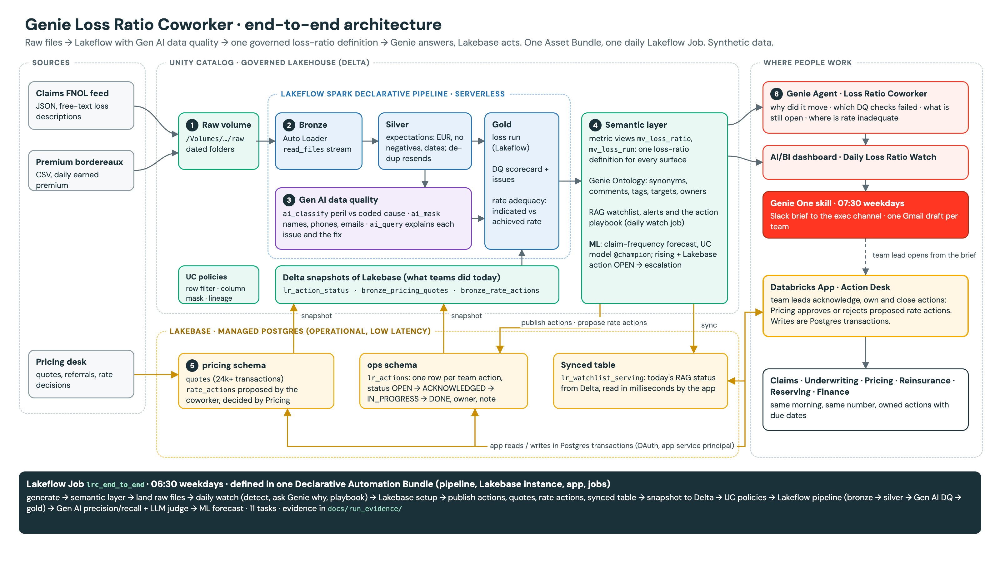

# Solution summary: from raw claim files to owned actions, every morning

## The business problem

A commercial P&C insurer sees its loss ratio once a month. In a market where the combined ratio sits around 90–93%,
a few points of loss ratio decide the year, and they move between month-ends: a hailstorm in DACH, a motor frequency
creep in the UK, a single EUR 2.4m bodily-injury claim. By the time the month-end pack lands, the event is three weeks
old, reinsurers have not been notified, Pricing is still quoting the old rate, and nobody can say which team owns the fix.

Three things make it worse:

1. **The data is not trustworthy on day one.** Claims arrive as FNOL files from several systems. Cause-of-loss codes
   contradict the adjuster's description, people type names and phone numbers into free text, brokers resend files
   and send negative premiums. Rules catch the arithmetic errors; they cannot read a sentence.
2. **Analytics and operations live apart.** The loss ratio is in the lakehouse; the actions, owners and pricing
   decisions are in emails and spreadsheets. Nobody can ask "what is still open for Reinsurance?" and get an answer.
3. **Pricing reacts last.** The quoting desk keeps binding at the old rate in a segment that is already RED.

## What the coworker does (a morning in the life)

| Time | What happens | Built with |
|---|---|---|
| 06:30 | Claim FNOL files and premium bordereaux land in a Unity Catalog **volume** | `src/raw/03_land_raw_files.py` |
| 06:35 | **Lakeflow** ingests them with Auto Loader, enforces expectations, de-duplicates resends | `src/pipeline/lrc_ingest_pipeline.sql` |
| 06:40 | **Gen AI** reads every new claim description: `ai_classify` finds the peril and flags codes that contradict it, `ai_mask` removes personal data, `ai_query` explains each issue and the fix in plain English | same pipeline, `silver_claims_ai_checked`, `dq_claims_issues` |
| 06:45 | The daily watch detects RED/AMBER segments against targets, asks the **Genie Agent** *why*, applies the action playbook | `src/jobs/daily_loss_ratio_watch.py` |
| 06:50 | Actions are published to **Lakebase** (`ops.lr_actions`); for every Pricing action a **rate action** is proposed in the pricing system (`pricing.rate_actions`); quotes in RED segments are referred to a senior underwriter | `src/lakebase/02_publish_and_transact.py` |
| 07:30 | **Genie One** posts the brief in Slack and drafts one Gmail per team | `skills/loss-ratio-daily-brief.md` |
| 08:00–18:00 | Team leads open the **Action Desk** app, acknowledge, take and close their actions; Pricing approves or rejects the proposed rate change. Every click is a Postgres transaction | `app/action_desk/app.py` |
| Next run | Lakebase is snapshotted back to Delta, so Genie can answer *"what is still open for Reinsurance?"* and `gold_rate_adequacy` can compare the **indicated** rate change with the rate actually achieved on quotes | `src/lakebase/03_snapshot_to_delta.py`, `gold_rate_adequacy` |
| Every run | The Gen AI checks are scored against seeded defects (precision, recall) | `src/genai/04_evaluate_genai_dq.py` |

## Why each Databricks component is there

| Component | Role in the story | Why not something else |
|---|---|---|
| **Unity Catalog volume** | Landing zone for files from source systems, governed like tables | One permission model from raw file to Genie answer |
| **Lakeflow Spark Declarative Pipelines** | Bronze → silver → gold with Auto Loader, expectations and materialized views, serverless | Data-quality rules are declared next to the data and their results land in the event log, not in a separate tool |
| **AI Functions** (`ai_classify`, `ai_mask`, `ai_query`) | Data quality for unstructured text inside the pipeline | Runs where the data is, in SQL, under the same governance; no data leaves for an external LLM service |
| **Metric views + Genie Ontology** | One loss-ratio definition for the dashboard, the Genie Agent and Genie One | No second definition in a BI tool |
| **Genie Agent / Genie One** | Explains *why*, answers follow-ups, writes the brief, Slack post and Gmail drafts | Natural language over governed data, with the SQL visible |
| **Lakebase** | Low-latency operational store for actions, team status, quotes and rate actions; synced table serves today's watchlist | Rows that people *change* during the day need OLTP transactions, not Delta overwrites |
| **Databricks App** | The Action Desk team leads use; reads and writes Lakebase as its service principal | Hosted next to the data with workspace SSO; no separate web stack |
| **Lakeflow Jobs + Declarative Automation Bundle** | One job runs the whole chain; one bundle deploys pipeline, Lakebase instance, app and jobs | Reproducible in any workspace with `databricks bundle deploy` |

## Every step and its script

All steps are notebooks or scripts in this repo, and all run in the Lakeflow Job `lrc_end_to_end`
([`resources/lrc_jobs.yml`](../resources/lrc_jobs.yml)), except the one-off deploy scripts.

| # | Step | Script | Type | Writes |
|---|---|---|---|---|
| 1 | Synthetic book: policies, claims, daily earned premium, three seeded events | [`src/setup/01_generate_loss_run.py`](../src/setup/01_generate_loss_run.py) | notebook | `policies`, `claims`, `earned_premium_daily` |
| 2 | Semantic layer: gold loss run, targets, benchmarks, metric views, watchlist, Ontology metadata | [`src/setup/02_semantic_layer.py`](../src/setup/02_semantic_layer.py) | notebook | `gold_daily_loss_run`, `mv_loss_ratio`, `mv_loss_run`, `v_loss_ratio_watchlist`, `lr_targets` |
| 3 | **Raw files** with seeded data-quality defects into the UC volume | [`src/raw/03_land_raw_files.py`](../src/raw/03_land_raw_files.py) | notebook | `/Volumes/<catalog>/<schema>/raw/…` |
| 4 | Daily watch: detect, ask Genie why, playbook, Slack/Teams | [`src/jobs/daily_loss_ratio_watch.py`](../src/jobs/daily_loss_ratio_watch.py) | notebook | `lr_alerts`, `lr_action_recommendations` |
| 5 | **Lakebase setup**: instance, database, `ops` and `pricing` schemas, 24k seeded quotes | [`src/lakebase/01_setup_lakebase.py`](../src/lakebase/01_setup_lakebase.py) (+ helper [`_lakebase_conn.py`](../src/lakebase/_lakebase_conn.py)) | notebook | `ops.lr_actions`, `pricing.quotes`, `pricing.rate_actions` |
| 6 | **Lakebase transactions**: publish actions, record quotes and referrals, propose rate actions, create/refresh the synced table, grant the app | [`src/lakebase/02_publish_and_transact.py`](../src/lakebase/02_publish_and_transact.py) | notebook | Lakebase rows; `lr_watchlist_snapshot` → `lr_watchlist_serving` |
| 7 | **Lakebase → Delta** snapshot of team status and pricing | [`src/lakebase/03_snapshot_to_delta.py`](../src/lakebase/03_snapshot_to_delta.py) | notebook | `lr_action_status`, `bronze_pricing_quotes`, `bronze_rate_actions` |
| 8 | **Lakeflow ETL + Gen AI data quality**: bronze (Auto Loader) → silver (expectations, de-dup) → `ai_classify` / `ai_mask` / `ai_query` → gold | [`src/pipeline/lrc_ingest_pipeline.sql`](../src/pipeline/lrc_ingest_pipeline.sql) ([`resources/lrc_pipeline.yml`](../resources/lrc_pipeline.yml)) | Lakeflow SDP (SQL) | `bronze_fnol`, `bronze_premium`, `silver_claims`, `silver_premium`, `silver_claims_ai_checked`, `dq_claims_issues`, `dq_daily_scorecard`, `gold_daily_loss_run_lf`, `gold_rate_adequacy` |
| 9 | **Gen AI evaluation**: precision/recall of the AI checks against seeded defects | [`src/genai/04_evaluate_genai_dq.py`](../src/genai/04_evaluate_genai_dq.py) | notebook | `dq_genai_eval` |
| 10 | Genie Agent with DQ, team-status and pricing tables | [`deploy/genie_agent.py`](../deploy/genie_agent.py) | script | Genie space |
| 11 | AI/BI dashboard | [`deploy/dashboard.py`](../deploy/dashboard.py) | script | Lakeview dashboard |
| 12 | **Action Desk app on Lakebase** | [`app/action_desk/app.py`](../app/action_desk/app.py) ([`resources/lrc_app.yml`](../resources/lrc_app.yml)) | Databricks App | updates `ops.lr_actions`, `pricing.rate_actions` |
| 13 | Genie One skill: brief → Slack → Gmail drafts | [`skills/loss-ratio-daily-brief.md`](../skills/loss-ratio-daily-brief.md) | Genie One skill | Slack post, Gmail drafts |
| 14a | **Genie Agent benchmark**: ask the deployed agent, capture its SQL and result, score against ground truth | [`deploy/genie_benchmark.py`](../deploy/genie_benchmark.py) | script | [`run_evidence/06_genie_agent.md`](run_evidence/06_genie_agent.md) |
| 14 | Collect run evidence into the repo | [`deploy/collect_run_evidence.py`](../deploy/collect_run_evidence.py) | script | [`docs/run_evidence/`](run_evidence/) |

Infrastructure as code: [`databricks.yml`](../databricks.yml) + [`resources/`](../resources/) (Lakebase instance, pipeline,
app, jobs).

## Gen AI data quality in detail

| Check | How | Severity | Why it matters |
|---|---|---|---|
| Peril vs coded cause | `ai_classify(loss_description, <15 perils>)`, mapped to allowed cause codes | High | A hail claim coded as theft lands in the wrong reinsurance treaty and the wrong frequency model |
| Personal data in free text | `ai_mask(loss_description, ['person','phone number','email'])`; masked text is the only version used downstream | High | GDPR: free text is copied into briefs, emails and Genie answers |
| Explanation and fix | `ai_query(<FM endpoint>, prompt with check, codes, amount and masked text)` | — | The claims handler gets a two-sentence fix, not a rule ID |
| Negative amounts, loss after report, non-EUR | Lakeflow expectations + rules | Medium | Arithmetic errors that would distort the loss ratio |

Cost control: AI checks run only on the last `ai_lookback_days` report days (default 14) and on materialized views,
so each claim is classified once per refresh window. Accuracy is measured every run in `dq_genai_eval`.

## Lakebase in detail

| Postgres object | Written by | Read by | Why OLTP |
|---|---|---|---|
| `ops.lr_actions` | daily job (insert, `ON CONFLICT DO NOTHING` keeps team edits); Action Desk (update status, owner, note) | Action Desk; Genie via `lr_action_status` | Many small concurrent updates by people during the day |
| `pricing.quotes` | pricing desk (simulated, 300/day, RED segments referred) | `gold_rate_adequacy` via snapshot | A transactional system of record |
| `pricing.rate_actions` | coworker proposes (idempotent on `source_action_id`); Pricing approves/rejects in the app | Action Desk; `gold_rate_adequacy`; Genie | Decision workflow with an audit trail |
| `lr_watchlist_serving` | **synced table** from Delta `lr_watchlist_snapshot` | Action Desk (millisecond reads) | Serve lakehouse results to an app without a warehouse round trip |

Security: no passwords. Notebooks and the app use short-lived OAuth database credentials; the app connects as its own
service principal, granted `SELECT` on what it reads and `UPDATE` only on the two tables it changes.

## Genie Agent: measured, not assumed

[`deploy/genie_benchmark.py`](../deploy/genie_benchmark.py) asks the deployed Genie Agent CUO-style questions through
the Genie Conversation API and scores each answer against a ground-truth query on the same governed tables. The first
run scored **9/10**: asked how many claims had personal data, Genie guessed a filter (`check_name ILIKE '%personal%'`)
and returned 6 instead of 87. The fix was business context, not a model change: one instruction listing the exact
`check_name` values. Re-run: **10/10**. Questions, Genie's SQL and results are in
[`run_evidence/06_genie_agent.md`](run_evidence/06_genie_agent.md); extending it to the 20-question CUO set is the
week-3 go-live gate (≥ 90%).

## What the executives are measured on

| Executive | KPI on their scorecard | How the coworker moves it |
|---|---|---|
| Chief Underwriting Officer | Underwriting result, accident-year loss ratio vs plan | Segment drift seen in days; rate inadequacy flagged with indicated vs achieved rate |
| CFO | Combined ratio, earnings volatility, reserve adequacy | One governed number in Power BI and Genie; event IBNR booked the same week |
| Chief Claims Officer | Claims leakage, cycle time, data quality | Wrong cause codes and personal data caught on arrival, each with a fix |
| Head of Reinsurance | Recoveries collected, notification within treaty deadlines | P1 action with a 48-hour due date, tracked to DONE in Lakebase |
| Chief Pricing Actuary | Rate adequacy, rate change achieved vs plan | Rate action proposed the same morning; RED-segment quotes referred |

The strategic shift: from a monthly reporting cycle to a daily operating rhythm, where the data platform does not just
report the loss ratio but routes each signal to an owner and records what was done.

## Outcomes (from the committed run)

See [`run_evidence/README.md`](run_evidence/README.md) for the numbers from the latest real run: tasks and durations,
expectation pass/fail counts, Gen AI findings with explanations, Gen AI precision and recall, the reconciliation of
the Lakeflow gold loss run against the original, rate adequacy per segment, and team status from Lakebase.

| Before | After |
|---|---|
| Loss ratio seen monthly | Seen every morning, with the driver and an owner |
| DQ issues found at month-end reconciliation | Found on arrival; every issue explained, personal data masked before it spreads |
| Actions in email threads | Actions in Lakebase with status, owner and note; Genie can report on them |
| Pricing hears last | A rate action is proposed the same morning; RED-segment quotes are referred |
| "Which number is right?" | One metric-view definition; Lakeflow gold reconciles to the original gold |
